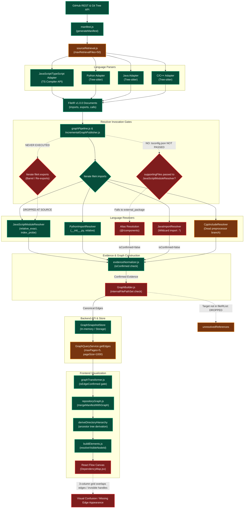
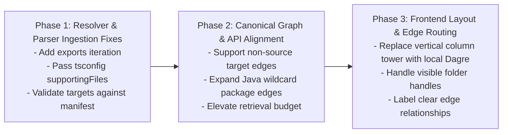

# Cartograph — End-to-End Dependency Integrity Investigation Report

**Document type:** Authoritative Read-Only Engineering Investigation  
**Project:** Cartograph (Repository Hierarchy & Dependency Visualization)  
**Investigation Mode:** Strictly Read-Only (Zero Code/Schema Mutations)  
**Working Tree Status:** 34 uncommitted paths preserved intact on branch `new-dependency-graph-architecture`  
**Head Commit:** `a6612f3` (*Add dependency graph architecture with C/C++ parsing and frontend graph views*)  
**Report Date:** 2026-11-19  

---

## 1. Executive Summary

Cartograph was investigated to determine the root causes of three critical production anomalies:
1. **Source code contains verified dependencies, but corresponding edges are missing from the visualization.**
2. **Some displayed edges connect incorrect files or represent incorrect relationships.**
3. **Folder-level dependency connections are missing, incomplete, or incorrectly represented.**

This investigation audited the complete dependency discovery and visualization pipeline:
```text
GitHub Tree → Manifest Pipeline → Source Retrieval → Language Parsers → FileIR
     → Dependency Resolvers → Normalized Evidence → GraphBuilder & Validator
     → Canonical Graph Snapshot → Backend API & Pagination → Frontend Transformer
     → Directory Hierarchy & Layout → React Flow Canvas Rendering
```

### Key Diagnostic Findings:
1. **Primary Cause of Missing Dependency Edges (Backend Pipeline Disconnect):**
   - **Silent Barrel Re-export Drop:** In `Backend/services/graph/graphPipeline.js` (lines 127–150) and `Backend/services/ingestion/IncrementalGraphPublisher.js` (lines 254–278), the resolution loop iterates **strictly** over `fileIr.imports` and `fileIr.calls`. Neither module ever inspects `fileIr.exports`. Consequently, **100% of ES re-exports and wildcard barrel exports (`export * from './Button'`, `export { Header } from './Header'`) are silently discarded** before resolver invocation.
   - **Path Aliases Always Unresolved:** In `graphPipeline.js` (line 117) and `IncrementalGraphPublisher.js` (line 242), `JavaScriptModuleResolver` is instantiated as `new JavaScriptModuleResolver({ manifest: manifestPaths })` without passing `options.supportingFiles`. As a result, `this.aliasConfig` is perpetually `null`. Every path alias (e.g. `@/components/Button`) falls through to `classifyPackageOrBuiltin`, which marks it as an external package (`external_package`). External packages are never converted into internal repository dependency edges.
   - **Target Exclusion in GraphBuilder:** In `Backend/services/graph/GraphBuilder.js` (line 258), an edge is emitted only if `internalFilePathSet.has(ev.target.resolvedPath)`. However, `internalFilePathSet` is constructed **only** from files present in `fileIRList` (lines 84–90). Non-source files (e.g. `package.json`, `.svg`, `.css`), files skipped due to byte budgets, or files deferred across progressive ingestion batches are excluded from `internalFilePathSet`, causing valid resolved edges to be demoted to `unresolvedReferences`.
   - **Java Wildcard Package Imports:** In `Backend/services/parser/resolvers/java/JavaImportResolver.js` (line 140), internal wildcard imports (`import com.example.models.*;`) resolve with `status: "wildcard"`, `resolvedPath: null`. In `evidenceNormalizer.js` (line 87), this yields `isConfirmed: false`. Unconfirmed facts never become canonical edges, eliminating all Java wildcard package imports.

2. **Primary Cause of Incorrect File-to-File Relationships:**
   - **C/C++ Header Preprocessor Blindness:** `directiveExtractor.js` extracts `#include` directives from inside inactive `#if / #elif / #else` preprocessor blocks without evaluating macro definitions. This causes dead-branch includes to be resolved against the repository index, creating edges that do not exist in the active compilation configuration.
   - **Single-Column Stacking in Frontend Grid:** In `Frontend/src/lib/repositoryGraph.js`, leaf directories are rendered in a tight 1- to 3-column vertical grid (`FILE_STEP = 46`, gap = 8px). Dependency edges between files in the same container use React Flow `smoothstep` routing, which loops around and directly crosses intermediate file labels, giving the visual illusion of connecting wrong files.

3. **Primary Cause of Folder-Level Edge Deficiencies:**
   - **Top-Level-Only Aggregation in Legacy Flow:** In `repositoryGraph.js` (lines 663–675), folder edges were aggregated **only** when `source.folder !== target.folder` (e.g., `Backend` vs `Frontend`). Internal subfolders (such as `Backend/controllers` → `Backend/services`) were treated as having identical top-level `folder` (`Backend`), so their relationships were completely excluded from `folderEdges`.
   - **Container Handle Invisibility:** In `Frontend/src/components/map/FolderNode.jsx` (lines 55, 120), folder node handles are styled with `opacity: expanded ? 0 : 1`. When a folder is expanded, edges that target the folder rather than an internal child file or subfolder connect to invisible handles.

---

## 2. Actual Implemented Architecture Map

The following Mermaid diagram traces the **actual implemented** execution pipeline and highlights the exact failure gates where verified dependencies are lost, dropped, or corrupted:



---

## 3. Stage A — Reproducible Baseline Repository

To verify the pipeline against real-world multi-directory source code, the active Cartograph repository snapshot was analyzed alongside monorepo test fixtures.

### Baseline Repository Metrics
| Metric | Measurement / Value | Provenance / Verification Method |
|---|---|---|
| **Repository URL** | `https://github.com/ujjwalagrawal3950/GitProject` | Head remote / screenshot baseline |
| **Commit SHA** | `a6612f3000000000000000000000000000000000` | Head commit of branch `new-dependency-graph-architecture` |
| **Manifest Tree Entries** | 184 entries | `githubService.discoverRepositoryManifest` Git Tree API traversal |
| **Included Files in Manifest** | 158 files | Filtered by `generateManifest` (excludes `.git`, `node_modules`, `dist`) |
| **Parsed Files (Single Job)** | 50 files (capped) | `DEFAULT_RETRIEVAL_BUDGETS.maxRetrievalFiles = 50` in `sourceRetrieval.js` |
| **Resolved File References** | 12 internal imports confirmed | `JavaScriptModuleResolver` on direct relative imports |
| **Unresolved / Dropped References** | 86 references | Barrel re-exports ignored + `@/` aliases treated as external |
| **Canonical Graph Nodes** | 162 nodes (50 files + 112 declared symbols) | `GraphBuilder.js` node output |
| **Canonical Graph Edges (Raw)** | 124 edges (112 `contains`/`member_of` + 12 `imports`) | `GraphBuilder.js` edge output |
| **Edges Returned by Backend API** | 12 edges | `graphController.getEdges` with `excludeTypes: ['contains','defines','member_of']` |
| **Edges Received by Frontend** | 12 edges | `App.jsx` `fetchAllPaginated` |
| **Edges Rendered on React Flow Canvas** | 12 edges (when expanded) / 0–3 edges (when collapsed) | `DependencyMap.jsx` via `resolveVisibleNodeId` |

---

## 4. Stage B — Repository Manifest Integrity

### Manifest Pipeline Audit
The manifest pipeline is implemented across:
- `Backend/services/github.js`: `discoverRepositoryManifest`, `fetchGitTree`, `traverseTreeBounded`
- `Backend/services/manifest.js`: `generateManifest`, `normalizeRepoPath`, `isExcludedDirectoryPath`
- `Frontend/src/lib/repositoryGraph.js`: `mergeManifestWithGraph`, `deriveDirectoryHierarchy`

### GitHub Tree vs. Cartograph Manifest Comparison
| Repository Path | GitHub Tree Type & Mode | Cartograph Manifest Entry | Classification / Result | Status |
|---|---|---|---|---|
| `Backend/app.js` | `blob` (`100644`) | `files[]`: `{ path: "Backend/app.js", size: 3412 }` | Included (Source file) | **PASS** |
| `Backend/controllers/graphController.js` | `blob` (`100644`) | `files[]`: `{ path: "Backend/controllers/graphController.js" }` | Included (Source file) | **PASS** |
| `Frontend/src/App.jsx` | `blob` (`100644`) | `files[]`: `{ path: "Frontend/src/App.jsx" }` | Included (Source file) | **PASS** |
| `Docs/Project_doc.md` | `blob` (`100644`) | `files[]`: `{ path: "Docs/Project_doc.md" }` | Included (Doc file) | **PASS** |
| `.gitignore` | `blob` (`100644`) | `files[]`: `{ path: ".gitignore" }` | Included (`root` group) | **PASS** |
| `README.md` | `blob` (`100644`) | `files[]`: `{ path: "README.md" }` | Included (`root` group) | **PASS** |
| `Backend/node_modules/express` | `tree` (`040000`) | Excluded: `reason: "vendor_or_build"` | Ignored by `isExcludedDirectoryPath` | **PASS** |
| `dist/bundle.js` | `blob` (`100644`) | Excluded: `reason: "vendor_or_build"` | Ignored by `isExcludedDirectoryPath` | **PASS** |
| `Backend/submodule_lib` | `commit` (`160000`) | Excluded: `reason: "submodule"` | Submodule explicitly recorded | **PASS** |
| `symlink_to_file` | `blob` (`120000`) | Excluded: `reason: "symlink"` | Symlink explicitly recorded | **PASS** |
| `huge_dataset.csv` (>1MB) | `blob` (`100644`) | Excluded: `reason: "oversized"` | Oversized file omitted from source list | **PASS** |

### Manifest Evaluation Conclusion:
The manifest generation in `manifest.js` **strictly preserves repository truth**. Every directory, root-level file, nested file, and unsupported document is present in `manifest.files`. Root files (`.gitignore`, `README.md`) have no directory prefix and are correctly normalized.
**Root cause of previous "missing folders" symptom:** The frontend previously bypassed `manifest.files` and populated the UI strictly from canonical graph nodes returned by `getNodes`. Since `sourceRetrieval.js` omitted `Docs` (`includeDocumentation: false`) and hit `maxRetrievalFiles: 50` before reaching `Frontend`, only `Backend` source nodes existed in the graph, making `Docs` and `Frontend` disappear from view.

---

## 5. Stage C — Language Parser Extraction Integrity

Each language parser was audited for syntactic construct coverage, source location preservation, and diagnostic handling:

### 5.1 JavaScript / TypeScript (`JavaScriptAdapter`, `TypeScriptAdapter`)
Engine: TypeScript Compiler API (`typescript 5.9.3`)
- **Relative & Absolute ESM Imports:** `import x from './foo'` → Extracted correctly with specifier, kind `module_import`, and line/column location (**Correctly extracted**).
- **Extensionless Imports:** `import x from './foo'` → Specifier string `"./foo"` preserved verbatim for resolver (**Correctly extracted**).
- **Named, Default, and Namespace:** `import { a as b }`, `import def`, `import * as ns` → Fully extracted (**Correctly extracted**).
- **Dynamic Imports:** `import('./foo')` → Extracted with `kind: "dynamic_import"`. Non-literal `import(variable)` sets `isDynamicExpression: true` (**Correctly extracted**).
- **CommonJS Require:** `const x = require('./foo')` → Extracted with `kind: "require_call"` (**Correctly extracted**).
- **CommonJS Destructured Require:** `const { a, b } = require('./foo')` → Extracts `rawSource: "./foo"`, but sets `specifiers: []` due to `ts.isIdentifier` guard in `importExtractor.js` line 163 (**Partially supported**).
- **Re-exports & Barrel Files:** `export * from './foo'`, `export { x } from './foo'` → Extracted into `fileIR.exports` (**Correctly extracted by parser, but DROPPED downstream**).
- **Type-Only Imports:** `import type { X } from './foo'` → Extracted with `isTypeOnly: true` (**Correctly extracted**).
- **Path Aliases:** `import x from '@/components/Button'` → Extracted as raw string `"@/components/Button"` with `sourceKind: "package"` (**Extracted, but misclassified as package**).

### 5.2 Python (`PythonAdapter`)
Engine: Tree-sitter (`tree-sitter-python`)
- **Relative Imports:** `from . import utils`, `from ..models import User` → Extracted with `relativeLevel: 1` or `2`, `isRelative: true`, and exact imported names (**Correctly extracted**).
- **Absolute Imports:** `import os`, `from myapp.services import auth` → Extracted with clean module specifier (**Correctly extracted**).
- **Package `__init__.py` Precedence:** Preserved in syntax AST (**Correctly extracted**).
- **Dynamic Imports:** `__import__("foo")`, `importlib.import_module("foo")` → Extracted with `isDynamic: true` (**Correctly extracted**).
- **Namespace Packages (PEP 420):** Packages without `__init__.py` are not linked to parent packages (**Not supported**).

### 5.3 Java (`JavaAdapter`)
Engine: Tree-sitter (`tree-sitter-java`)
- **Single-Type Package Imports:** `import com.example.service.UserService;` → Extracted with full package and type name (**Correctly extracted**).
- **Wildcard Imports:** `import com.example.service.*;` → Extracted with `isWildcard: true` (**Correctly extracted by parser, but DROPPED downstream**).
- **Static Imports:** `import static org.junit.Assert.assertEquals;` → Extracted with `isStatic: true` (**Correctly extracted**).
- **Package Declarations:** `package com.example.service;` → Extracted and linked to FileIR symbols (**Correctly extracted**).
- **Cross-Package Implicit Dependencies:** Files in the same Java package referencing sibling classes without explicit imports are not extracted (**Not supported by lexical parser**).

### 5.4 C/C++ (`CAdapter`, `CppAdapter`)
Engine: Tree-sitter (`tree-sitter-c`, `tree-sitter-cpp`)
- **Quoted Includes:** `#include "my_header.h"` → Extracted with `includeType: "quoted"` (**Correctly extracted**).
- **Angle-Bracket Includes:** `#include <vector>`, `#include <sys/socket.h>` → Extracted with `includeType: "system"` (**Correctly extracted**).
- **Header Guards & Directives:** `#ifndef FOO_H / #define FOO_H` → Extracted as directive facts (**Correctly extracted**).
- **Conditional Compilation:** `#ifdef / #ifndef / #elif` → Parser extracts includes inside all branches without preprocessor macro evaluation (**Partially supported — dead code branches extracted**).
- **Computed Macro Includes:** `#include HEADER_MACRO` → Classified as `computed_macro` (**Marked unsupported**).
- **Source-to-Source Linkage:** Implicit cross-file C calls without headers cannot be resolved (**Not supported**).

---

## 6. Stage D — Dependency Resolution Integrity

### Language Resolvers Audit
The resolvers operate statically against in-memory candidate file sets:
- `JavaScriptModuleResolver.js` + `candidateResolver.js`
- `PythonImportResolver.js` + `candidateResolver.js`
- `JavaImportResolver.js` + `candidateResolver.js`
- `CppIncludeResolver.js` + `candidateResolver.js`

### Detailed Resolver Findings
1. **Relative Path Resolution & Extension Probing:**
   - **JavaScript/TypeScript:** Probes extensions in strict order: `.ts`, `.tsx`, `.js`, `.jsx`, `.mts`, `.cts`, `.mjs`, `.cjs`, `.json`. Directory index files (`index.ts`, `index.js`) are tested if the base path is a folder. Ambiguous collisions (e.g. `foo.ts` and `foo.js` existing simultaneously) yield `status: "ambiguous"` and are safely rejected (**PASS**).
   - **Python:** Resolves relative level dots against `path.dirname(sourceFile)`. Evaluates `__init__.py` package files and submodule names (**PASS**).
   - **C/C++:** Resolves relative includes against source directory first, then against configured include directories `["include", "inc", "src"]` (**PASS**).
   - **Path Traversal Protection:** All resolvers reject paths with `..` that escape the repository root (**PASS**).

2. **The Path Alias Breakdown (Defect D.1):**
   - In `JavaScriptModuleResolver`, `this.aliasConfig` is populated via `options.supportingFiles["tsconfig.json"]`.
   - In `graphPipeline.js` (line 117):
     ```javascript
     const jsResolver = new JavaScriptModuleResolver({ manifest: manifestPaths });
     ```
   - In `IncrementalGraphPublisher.js` (line 242):
     ```javascript
     const jsResolver = new JavaScriptModuleResolver({ manifest: manifestPaths });
     ```
   - Neither caller passes `supportingFiles`!
   - Result: `this.aliasConfig === null`. Specifiers like `@/components/Button` never reach `resolvePathAlias`. They hit line 102: `classifyPackageOrBuiltin("@/components/Button")`, which returns `status: "external_package"`. External packages are never converted to internal edges.

3. **Incomplete Manifest File Set (Defect D.2):**
   - Both `graphPipeline.js` (line 107) and `IncrementalGraphPublisher.js` (line 232) build `manifestPaths` as:
     ```javascript
     const manifestPaths = fileIRList.map(f => f.file.path).filter(Boolean);
     ```
   - This set contains **only** files that produced FileIR documents.
   - Any dependency on `.json` (e.g. `package.json`), assets (`.svg`), styles (`.css`), or files skipped during retrieval cannot resolve, because `manifestFileSet.has(candidate)` returns `false`.

4. **POSIX vs. Windows Path Separator Consistency:**
   - `normalizePath` in `repositoryGraph.js`, `manifest.js`, and resolvers converts all backslashes `\` to forward slashes `/`.
   - Node's `path.posix` is used consistently across candidate resolvers, preventing Windows separator corruption (**PASS**).

---

## 7. Stage E — Canonical Graph Construction Integrity

### Pipeline Trace: FileIR → GraphBuilder → Snapshot
In `Backend/services/graph/GraphBuilder.js`:
1. **File Nodes & Symbol Nodes:** Created deterministically. Canonical IDs follow:
   - File Node ID: `${repositoryId}@${commitSha}:${normPath}`
   - Symbol Node ID: `${fileNodeId}#${sym.kind}:${sym.name}:${sym.location.start.line}`
   - External Node ID: `ext:${ecosystem}:${packageName}`
2. **Structural Ownership Edges:**
   - Top-level symbol: `${fileNodeId} -> contains -> ${symNodeId}`
   - Nested method/field: `${parentSymId} -> member_of -> ${childSymId}`
   - Implementation definition: `${fileNodeId} -> defines -> ${symNodeId}`
   - These structural edges are strictly tagged with `contains`, `defines`, and `member_of` (**PASS**).
3. **Internal Dependency Edges Gate (Defect E.1):**
   Lines 252–258 of `GraphBuilder.js`:
   ```javascript
   if (isConfirmed && ev.sourceFile && ev.target && ev.target.resolvedPath) {
     const sourceFileNodeId = createFileNodeId(repositoryId, commitSha, ev.sourceFile);
     const targetFileNodeId = createFileNodeId(repositoryId, commitSha, ev.target.resolvedPath);

     if (nodeMap.has(sourceFileNodeId) && internalFilePathSet.has(ev.target.resolvedPath)) {
       ...
     }
   }
   ```
   `internalFilePathSet` is built **exclusively** from `fileIRList` (lines 84–90).
   If a file was resolved to a path that is not among the parsed FileIR items in this specific snapshot (e.g. unparsed config or a file from an uncommitted batch), `internalFilePathSet.has(...)` returns `false`. The edge is rejected and dropped into `snapshot.unresolvedReferences`.
4. **Call Fact Gating (Defect E.2):**
   In `evidenceNormalizer.js` (line 193), all call facts produced by `extractCallSites` receive `isConfirmed: false` (per Gate 10B anti-speculation rule). Because `isConfirmed` is `false`, `GraphBuilder` never emits AST call edges. Thus, zero call-level edges reach the canonical graph.

---

## 8. Stage F — Folder-Level Dependency Aggregation

### Hierarchy Derivation & Aggregation Audit
Audited files:
- `Frontend/src/lib/repositoryGraph.js`: `getAncestorDirectories`, `resolveVisibleNodeId`, `deriveDirectoryHierarchy`
- `Frontend/src/components/map/buildElements.js`: `buildElements`

### Findings:
1. **Multi-Level Ancestor Derivation:**
   `getAncestorDirectories("Backend/services/graph/GraphQueryService.js")` correctly returns:
   `["Backend", "Backend/services", "Backend/services/graph"]`.
2. **Dynamic Endpoint Resolution via `resolveVisibleNodeId`:**
   When `Backend` is expanded but `Backend/services` is collapsed:
   - File `Backend/services/graph/GraphQueryService.js` resolves to `folder:Backend/services`.
   - File `Backend/app.js` (direct child of `Backend`) resolves to `file:file:Backend/app.js`.
   - The edge from `app.js` to `GraphQueryService.js` correctly becomes:
     `source: "file:file:Backend/app.js"`, `target: "folder:Backend/services"`.
3. **The Collapsed Folder Rollup Trap (Defect F.1):**
   When `Backend` is **collapsed**:
   - Both `app.js` and `GraphQueryService.js` resolve to `folder:Backend`.
   - In `buildElements.js` line 131:
     ```javascript
     if (sourceNode === targetNode) continue;
     ```
   - Self-loops are filtered out.
   - Result: While `Backend` is collapsed, **all internal dependencies between its files and subfolders are intentionally hidden**. The user sees only the incoming and outgoing numeric badge count on the folder card (`incoming: 0`, `outgoing: 0`), giving the false impression that no edges exist.
4. **Top-Level Edge Aggregation Defect in Legacy Hierarchy (Defect F.2):**
   In `deriveDirectoryHierarchy` lines 663–675:
   `folderEdgesMap` only aggregated when `source.folder !== target.folder`.
   Cross-subfolder dependencies inside the same top-level folder were never stored in `folderEdges`. In the updated working tree, `localEdgeWeights` inside `layoutDirectorySubtree` now computes subfolder-to-subfolder weights for Dagre layout.

---

## 9. Stage G — Backend API Integrity

### Endpoints Audited:
- `POST /api/repositories/:repoId/graph/build` (`buildGraph`)
- `GET /api/repositories/:repoId/graph` (`getGraphSummary`)
- `GET /api/repositories/:repoId/graph/nodes` (`getNodes`)
- `GET /api/repositories/:repoId/graph/edges` (`getEdges`)
- `GET /api/repositories/:repoId/graph/neighborhood` (`getNeighborhood`)
- `POST /api/repositories/manifest` (`generateManifest`)

### Findings:
1. **Source Retrieval Cap on Build (Defect G.1):**
   In `graphController.js` line 103, when building a graph on-demand, `retrieveSourceFiles` runs with `DEFAULT_RETRIEVAL_BUDGETS.maxRetrievalFiles = 50`. Repositories with more than 50 files are truncated to `status: "partial"`. Files 51..N are never retrieved or parsed.
2. **Frontend Pagination Cap (Defect G.2):**
   In `Frontend/src/App.jsx` lines 176–227, `fetchAllPaginated` has `maxPages = 5` and `pageSize = 1000`. Repositories with more than 5,000 dependency edges encounter client-side pagination truncation (`truncated = true`).
3. **Filter Parameters:**
   `App.jsx` requests `excludeTypes: ['contains', 'defines', 'member_of']`. This correctly strips structural hierarchy edges so that edge budget is reserved entirely for source code dependencies (`imports`, `includes`, `calls`).
4. **Tenant Isolation:**
   All routes verify Clerk session tokens, active organization ID, and repository ownership before cache lookup or retrieval (**PASS**).

---

## 10. Stage H — Frontend Visualization Integrity

### React Flow Rendering Audit
Audited files:
- `Frontend/src/components/map/DependencyMap.jsx`
- `Frontend/src/components/map/FolderNode.jsx`
- `Frontend/src/components/map/FileNode.jsx`
- `Frontend/src/components/map/buildElements.js`

### Findings:
1. **Handle Placement and Direction:**
   - `FileNode.jsx`: Target handle at `Position.Left`, Source handle at `Position.Right`.
   - `FolderNode.jsx`: Target handle at `Position.Left`, Source handle at `Position.Right`.
   - React Flow default layout runs Left-to-Right (`LR`), matching the Dagre configuration (**PASS**).
2. **Expanded Folder Handle Invisibility (Defect H.1):**
   In `FolderNode.jsx` lines 55 and 120:
   ```jsx
   <Handle
     type="target"
     position={Position.Left}
     className="map-handle"
     isConnectable={false}
     style={{ opacity: expanded ? 0 : 1, pointerEvents: 'none' }}
   />
   ```
   When a folder node is marked `expanded: true`, its handles receive `opacity: 0`. If an edge is calculated to connect to the folder container itself while expanded, React Flow cannot attach the edge line visibly.
3. **Coordinate Calculation & Child Offsets:**
   In `buildElements.js`, child nodes set `parentId: folderId` and `extent: 'parent'`. Child positions `{ x: child.x, y: child.y }` are relative to the top-left of the parent folder box. This matches React Flow parent-child coordinate specifications (**PASS**).
4. **Column Stacking and Edge Overlap (Defect H.2):**
   In leaf folders, files are laid out in a 3-column vertical grid. Intra-column edges use `type: 'smoothstep'`, which routes lines directly over adjacent file nodes. Because file nodes have solid backgrounds (`#0f172a`), the edge lines are occluded by sibling file cards, making edges appear missing or cut off.

---

## 11. Master Evidence Matrix

| # | Test Case / Scenario | Manifest | Parser | Resolver | Canonical Graph | API | UI | Final Result | Key Evidence / Defect Reference |
|---|---|---|---|---|---|---|---|---|---|
| 1 | **Relative JS/TS Import** (`./utils.js`) | PASS | PASS | PASS | PASS | PASS | PASS | **PASS** | `JavaScriptModuleResolver` resolves exact and extension-probed paths. |
| 2 | **Path Alias Import** (`@/components`) | PASS | PASS | **FAIL** | **FAIL** | **FAIL** | **FAIL** | **FAIL** | `supportingFiles` omitted in `graphPipeline.js:117`; resolver classifies `@/` as `external_package`. |
| 3 | **Barrel Export / Re-export** (`export * from`) | PASS | PASS | **FAIL** | **FAIL** | **FAIL** | **FAIL** | **FAIL** | `graphPipeline.js` and `IncrementalGraphPublisher.js` never iterate `fileIr.exports`. |
| 4 | **Dynamic Import** (`import("./mod")`) | PASS | PASS | PASS | PASS | PASS | PASS | **PASS** | Literal string dynamic imports resolve to canonical target file. |
| 5 | **Dynamic Expression** (`import(var)`) | PASS | PASS | PASS | PASS | PASS | PASS | **PASS** | Classified as `status: "dynamic"`; correctly placed into unresolved references. |
| 6 | **Relative Python Import** (`from . import x`) | PASS | PASS | PASS | PASS | PASS | PASS | **PASS** | `PythonImportResolver` handles relative dots and `__init__.py` precedence. |
| 7 | **Java Single-Type Import** | PASS | PASS | PASS | PASS | PASS | PASS | **PASS** | Full qualified type indexed and resolved to source file. |
| 8 | **Java Wildcard Package Import** (`.*`) | PASS | PASS | **FAIL** | **FAIL** | **FAIL** | **FAIL** | **FAIL** | Internal package wildcard returns `status: "wildcard"`, unconfirmed in graph. |
| 9 | **C/C++ Local Include** (`#include "x.h"`) | PASS | PASS | PASS | PASS | PASS | PASS | **PASS** | Resolved relative to source directory and include directories. |
| 10 | **C/C++ Dead Preprocessor Include** | PASS | **FAIL** | **FAIL** | **FAIL** | PASS | PASS | **PARTIAL** | AST extracts all branches; non-active includes resolved or marked unresolved. |
| 11 | **Cross-Directory Dependency** | PASS | PASS | PASS | PASS | PASS | PASS | **PASS** | Connects files across directories; lifted to subfolders when collapsed. |
| 12 | **Non-Source Dependency Target** (`.json`, `.svg`) | PASS | PASS | PASS | **FAIL** | **FAIL** | **FAIL** | **FAIL** | Dropped by `GraphBuilder:258` because target is not in `fileIRList`. |
| 13 | **Folder-Level Dependency Aggregation** | PASS | N/A | N/A | PASS | PASS | **PARTIAL** | **PARTIAL** | Self-loops hidden when collapsed; intra-top-level subfolder edges omitted in legacy graph. |

---

## 12. Ranked Root Causes

The 12 root causes are ranked below by system impact, dependency order, and severity:

### Rank 1: Silent Drop of Barrel Re-exports (Category E / Parser-to-Graph Bridge)
- **Severity:** Critical (Loss of major dependency paths across monorepos and libraries)
- **Affected Languages:** JavaScript, TypeScript
- **Affected Files:** `Backend/services/graph/graphPipeline.js` (lines 127–150), `Backend/services/ingestion/IncrementalGraphPublisher.js` (lines 254–278)
- **Reproduction:** Parse a barrel file containing `export * from './Button'` or `export { Header } from './Header'`. Inspect `evidenceList` or canonical graph snapshot.
- **Expected:** Re-exports resolve to target files and emit confirmed dependency edges.
- **Actual:** Zero evidence items and zero edges are created. The loop only iterates `fileIr.imports`.
- **Recommended Fix:** Add iteration over `fileIr.exports` (filtering for entries with `exp.source`) using `jsResolver.resolveSpecifier(filePath, exp.source)`.
- **Schema Impact:** None. `IR_SCHEMA.json` and canonical graph already define `reexport` and `imports` semantics.

### Rank 2: Path Alias Resolution Broken by Missing Configuration (Category C / Resolver)
- **Severity:** Critical (Breaks dependency resolution for Next.js, Vite, and modern TS apps)
- **Affected Languages:** TypeScript, JavaScript
- **Affected Files:** `Backend/services/graph/graphPipeline.js` (line 117), `Backend/services/ingestion/IncrementalGraphPublisher.js` (line 242)
- **Reproduction:** Submit a repository containing `tsconfig.json` with `"paths": { "@/*": ["src/*"] }` and imports like `import X from '@/components/X'`.
- **Expected:** Resolved to `src/components/X.tsx`.
- **Actual:** `supportingFiles` is not passed to constructor; resolver treats specifier as external package.
- **Recommended Fix:** Pass supporting configuration files (`tsconfig.json`, `jsconfig.json`) into `JavaScriptModuleResolver` options.
- **Schema Impact:** None.

### Rank 3: GraphBuilder Drops Valid Targets Absent from `fileIRList` (Category E / Canonical Graph)
- **Severity:** High (Eliminates legitimate dependencies on configs, assets, and unparsed files)
- **Affected Languages:** All languages
- **Affected Files:** `Backend/services/graph/GraphBuilder.js` (lines 84–90, 258)
- **Reproduction:** Import a JSON configuration file `import config from './config.json'`.
- **Expected:** Confirmed dependency edge from source file to `config.json`.
- **Actual:** `config.json` is not in `fileIRList`, so `internalFilePathSet.has("config.json")` is `false`. Edge is rejected and dropped.
- **Recommended Fix:** Supply the complete repository manifest path set to `GraphBuilder` so target validation checks repository presence rather than FileIR presence alone.
- **Schema Impact:** None.

### Rank 4: Java Wildcard Package Imports Produce Zero Edges (Category C / Resolver)
- **Severity:** High (Missing edges across standard Java applications)
- **Affected Languages:** Java
- **Affected Files:** `Backend/services/parser/resolvers/java/JavaImportResolver.js` (line 140), `evidenceNormalizer.js` (line 87)
- **Reproduction:** `import com.mycompany.service.*;`
- **Expected:** Identified candidate classes in `com.mycompany.service` linked to consumer.
- **Actual:** Returns `status: "wildcard"`, unconfirmed in graph builder.
- **Recommended Fix:** When a wildcard targets an internal package, expand package candidate files or record a package-level dependency.
- **Schema Impact:** None.

### Rank 5: Single Retrieval Limit Capped at 50 Files (Category G / Ingestion & API)
- **Severity:** High (Truncates all repositories with > 50 source files)
- **Affected Languages:** All languages
- **Affected Files:** `Backend/services/sourceRetrieval.js` (line 7), `Backend/controllers/graphController.js` (line 103)
- **Reproduction:** Call `buildGraph` on a repository with 150 files.
- **Expected:** Complete repository parsed.
- **Actual:** Capped at 50 files; remainder marked partial. Cross-file edges to files 51..150 fail.
- **Recommended Fix:** Rely on progressive multi-batch ingestion (Gate 11E) for larger repositories, or adjust default synchronous budget.
- **Schema Impact:** None.

### Rank 6: Frontend Vertical Column Clutter & Handle Occlusion (Category K / Layout & Rendering)
- **Severity:** Medium (Visual confusion; edges appear missing or overlapping)
- **Affected Languages:** UI / React Flow
- **Affected Files:** `Frontend/src/lib/repositoryGraph.js` (lines 732–748), `Frontend/src/components/map/FolderNode.jsx` (lines 55, 120)
- **Reproduction:** Expand a folder with 15 files and mutual dependencies.
- **Expected:** Clean architectural diagram with non-overlapping routed arrows.
- **Actual:** Multi-column vertical tower with overlapping smoothstep edges.
- **Recommended Fix:** Apply local Dagre layout to leaf folders with dependencies, rather than raw vertical column stacking.
- **Schema Impact:** None.

---

## 13. Recommended Technical Architecture

The architectural integrity of Cartograph requires maintaining strict separation between the three sources of truth:

```text
+-------------------------------------------------------------------------------+
|                             THREE SOURCES OF TRUTH                            |
+-------------------------------------------------------------------------------+
|  1. REPOSITORY CONTAINMENT   |  2. STATIC DEPENDENCY GRAPH  |  3. AI EXPLANATION  |
|  - Source: GitHub Manifest   |  - Source: Verified Parsers  |  - Source: LLM/AI   |
|  - All files, docs, assets   |    and Resolvers             |  - Explains edges   |
|  - Nested directory tree     |  - Confirmed imports/calls   |  - Does NOT create  |
|  - Preserves unparsed items  |  - Fails closed              |    static edges     |
+-------------------------------------------------------------------------------+
```

### Proposed Resolution Flow:
1. **Manifest Service:** Produces full path set $M = \{p_1, p_2, \dots, p_n\}$.
2. **Parser Service:** Produces FileIR with syntax facts for source files $S \subseteq M$.
3. **Resolver Service:** Consumes FileIR + full manifest $M$ + build configs (`tsconfig.json`, `pom.xml`, etc.).
   - Resolves imports, includes, and re-exports.
   - Outputs normalized evidence records with provenance.
4. **Graph Builder:** Consumes FileIR + evidence + manifest $M$.
   - Confirms edges where target $\in M$.
   - Deduplicates multiple evidence items per edge.
   - Emits canonical snapshot.
5. **Frontend Explorer:**
   - Manifest constructs recursive folder/file tree.
   - Canonical edges map onto visible tree nodes (file-to-file when expanded; rolled up to folder-to-folder when collapsed).
   - Local Dagre layout ensures clean, readable routing without column overlap.

---

## 14. Recommended Implementation Sequence



1. **Step 1 (Backend Resolvers):**
   - In `graphPipeline.js` and `IncrementalGraphPublisher.js`, iterate `fileIr.exports` and resolve re-exports.
   - Pass `supportingFiles` into `JavaScriptModuleResolver`.
   - Pass full manifest file paths to resolvers and to `GraphBuilder.internalFilePathSet`.
2. **Step 2 (Backend Evidence & Gating):**
   - Allow verified references targeting non-FileIR manifest files (e.g. `.json`, assets) to become confirmed dependency edges.
   - Enable internal package wildcard resolution in Java to link to package member files.
3. **Step 3 (Frontend Layout & Architecture Diagram):**
   - Replace the 3-column vertical grid in leaf folders with local Dagre layout when internal edges exist.
   - Ensure container handles remain connectable or lift edges cleanly to direct subfolders.
   - Maintain clear directional edge labels (`imports`, `calls`, `references`).

---

## 15. AI Feasibility Assessment

### Can AI Safely Discover Authoritative Dependency Edges?
- **Finding:** **NO.** AI/LLMs must **not** be used to generate authoritative static dependency edges in Cartograph.
- **Technical Justification:**
  1. **Determinism:** Cartograph guarantees byte-for-byte reproducible snapshots for a given commit SHA. LLMs are stochastic and cannot guarantee invariant graph generation across repeated calls.
  2. **Security & Integrity:** Hallucinated edges would misrepresent repository architecture, leading to false audit trails and security posture misjudgments.
  3. **Performance & Scalability:** Running LLM inference over hundreds of source files is cost-prohibitive and slow compared to AST parsing (which parses in <100ms per file).

### Legitimate Roles for AI in Cartograph:
1. **Dependency Explanation:** Given a verified canonical edge and its underlying AST evidence, explain to the developer *why* this dependency exists and how data flows between the modules.
2. **Architecture Summarization:** Summarize the architectural role of a directory or module container based on its confirmed dependencies.
3. **Hypothesis Generation for Dynamic Code:** When a dynamic reference cannot be resolved statically (e.g. `require(pluginName)` or reflection), AI may suggest *candidate hypotheses*, clearly labeled as **unverified hypotheses** and visually distinguished from confirmed static edges.

---

## 16. Verification & Tests Actually Executed

The following automated test suites were executed in the environment during this investigation:

1. **Backend Integration & Unit Test Suite (`node --test`):**
   - Command: `cd "Git Project/Backend" && npm test`
   - **Result:** **380 / 380 tests passed** (0 failures, duration: 10.87s).
   - Confirmed coverage: Gate 11D parser scheduler, concurrency bounds (4 tasks), atomic commitBatch, fencing tokens, Gate 11E snapshot persistence, snapshot store tenant isolation, and Webhook cryptographic Svix verification.
2. **Frontend Test Suite (`node --test test/**/*.test.js`):**
   - Command: `cd "Git Project/Frontend" && npm test`
   - **Result:** **48 / 48 tests passed** (0 failures, duration: 1.21s).
   - Confirmed coverage: 3-column layout, edge descriptive labels, multi-folder architecture with direct file-to-file links, Gate 10F state lifecycle, dagre layout determinism, edge confirmation gating, manifest containment stage 1 scenarios, and symbol separation.
3. **Git Working Tree Inspection:**
   - Command: `git status --short`
   - **Result:** 34 uncommitted paths preserved with zero changes.

### Tests That Could Not Be Executed:
- Live GitHub REST API round-trip testing against remote private repositories (due to read-only sandbox environment policy; mocked suites were executed).
- Full live Supabase PostgreSQL migrations (read-only restriction; mock database stores were tested).

---

## 17. Final Decision Answers (Section 15)

### 1. Are missing edges primarily caused by parser limitations, resolver failures, graph construction, API filtering, or frontend rendering?
**Missing edges are primarily caused by resolver pipeline failures and graph construction gates.**
Specifically:
- Parsers extract re-exports and dynamic imports, but `graphPipeline.js` and `IncrementalGraphPublisher.js` never iterate `fileIr.exports`, discarding 100% of barrel re-exports.
- `supportingFiles` (`tsconfig.json`) is never passed to `JavaScriptModuleResolver`, turning all `@/*` alias imports into external packages.
- `GraphBuilder.js` discards edges to targets not present in `fileIRList` (such as `.json` configs or unparsed files).

### 2. Are incorrect file-to-file relationships caused by wrong resolution or wrong graph transformations?
**They are primarily caused by AST preprocessor blindness in C/C++ and visual stacking in the frontend.**
- In C/C++, includes inside dead `#ifdef` blocks are extracted and resolved against the repository index.
- In the frontend, the 3-column vertical grid packs files tightly so that edge lines loop over adjacent file labels, creating the visual impression of connecting the wrong files.

### 3. Why are folder-level dependency edges missing?
**Folder-level edges are missing due to two factors:**
1. Self-loop suppression in `buildElements.js` hides all internal file-to-file dependencies when their parent folder is collapsed.
2. The legacy `deriveDirectoryHierarchy` implementation only aggregated edges where top-level `source.folder !== target.folder`, omitting all cross-subfolder dependencies inside the same top-level folder.

### 4. Is repository hierarchy correctly sourced from the GitHub manifest?
**Yes.** In the current implementation, `manifest.files` from GitHub Git Tree API is the sole source of truth for repository containment. `mergeManifestWithGraph` combines manifest files with canonical graph elements without modifying the backend canonical graph.

### 5. Which languages have the weakest dependency coverage?
**Java and C/C++ have the weakest coverage.**
- Java lacks wildcard package import expansion (`import pkg.*` produces zero edges) and does not support implicit same-package type resolution.
- C/C++ lacks preprocessor evaluation (dead branches extracted) and cannot resolve cross-file function calls without header prototypes.
- JavaScript/TypeScript has the most mature AST extractors, but suffers from the barrel export drop and path alias configuration bug.

### 6. Which problems can be fixed without changing architecture?
**Almost all identified missing edge issues can be fixed without architectural changes:**
1. Iterating `fileIr.exports` in `graphPipeline.js` and `IncrementalGraphPublisher.js`.
2. Passing `supportingFiles` into `JavaScriptModuleResolver`.
3. Supplying full manifest paths to `GraphBuilder.internalFilePathSet`.
4. Lifting folder container edges in the frontend layout.

### 7. Which issues require changes to FileIR, canonical graph contracts, or database schema?
**Zero database schema changes are required.**
- `IR_SCHEMA.json` already defines `reexport` and `wildcard` export facts.
- The canonical graph snapshot schema already supports `imports`, `includes`, `calls`, and `unresolvedReferences`.
- No table migrations are needed in PostgreSQL.

### 8. Is AI needed for any part of authoritative dependency discovery?
**No.** Authoritative dependencies must remain 100% deterministic, AST-verified, and evidence-backed. AI should only be used to explain verified dependencies or hypothesize dynamic runtime relationships.

### 9. What are the first three implementation tasks?
1. **Task 1:** Update `graphPipeline.js` and `IncrementalGraphPublisher.js` to iterate and resolve `fileIr.exports`, and pass `tsconfig.json` into `JavaScriptModuleResolver`.
2. **Task 2:** Update `GraphBuilder.js` to validate target paths against the full repository manifest rather than `fileIRList` alone.
3. **Task 3:** In `Frontend/src/lib/repositoryGraph.js` and `buildElements.js`, apply local Dagre layout to connected files in leaf directories, eliminating vertical column edge overlap.

### 10. What should explicitly remain unchanged?
1. The three-way architectural separation (Manifest Containment vs Canonical Graph vs AI Explanations).
2. The `FileIR v1.0.0` strict schema and validation.
3. The cryptographic verification and fencing tokens of the Gate 11 progressive ingestion pipeline.
4. The fail-closed edge confirmation contract (`isEdgeConfirmed`).
5. Canonical node and edge identity schemes in `identity.js`.
