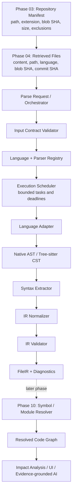

# Cartograph — Unified Code Intelligence Architecture (UCIA)

**Version:** 1.0  
**Status:** Proposed target architecture for Phase 05A review  
**Scope:** Parser foundation, normalized code IR, and boundaries for later symbol resolution and graph analysis  
**Existing stack:** React 19 + Vite + JSX, Tailwind CSS v3, Node.js + Express 5 + JavaScript, Clerk, Supabase PostgreSQL, GitHub REST/Git APIs, React Flow + Dagre

---

## 1. Executive recommendation

Build Cartograph around a **versioned, language-neutral Code Intelligence IR** produced by language-specific parser adapters.

The core pipeline is:

1. Phase 03 discovers repository files and produces the manifest.
2. Phase 04 retrieves selected content at an immutable commit and records blob SHA.
3. A parser facade dispatches each retrieved file to a language adapter.
4. The adapter extracts syntax facts from an AST/CST.
5. A normalizer maps those facts into the common IR.
6. A validator checks invariants and returns a `FileIR` plus diagnostics.
7. Later phases resolve references across files and create graph edges.
8. Graph, impact-analysis and AI features consume the normalized records—not parser-specific ASTs.

**Central rule:** parsing records what the source syntax proves. Resolution records what Cartograph can link to a concrete declaration. Inference or AI explanations must never silently become parser facts.

### Design goals

- Support all 15 languages already recognized by Phase 04.
- Preserve language-specific information without making downstream systems language-specific.
- Keep source provenance for every declaration and reference.
- Represent incomplete and malformed files without aborting the repository analysis.
- Make IDs deterministic within a repository revision.
- Keep parser execution bounded and treat repository content as untrusted.
- Avoid introducing a database schema, queue, microservice or worker system before it is needed.
- Keep the current application stack and existing Phase 01–04 contracts.

### Non-goals for this architecture milestone

- No cross-file import resolution.
- No final dependency graph or React Flow nodes/edges.
- No call-target resolution or whole-program type checking.
- No code execution, dependency installation, build invocation or compiler toolchain execution.
- No AI-generated symbols or relationships.
- No mandatory persistence of complete source contents or ASTs.

---

## 2. System architecture



### Component responsibilities

| Component | Responsibility | Must not do |
|---|---|---|
| Parse orchestrator | Accept a bounded set of retrieved files and coordinate per-file parsing | Re-fetch the repository or resolve imports |
| Input validator | Validate path, language, content type, commit and blob metadata | Trust client-supplied arbitrary URLs |
| Language registry | Map canonical language IDs to adapter metadata | Contain parser-specific extraction logic |
| Execution scheduler | Enforce concurrency, deadlines, cancellation and task limits | Claim worker threads are a security sandbox |
| Language adapter | Parse one file and extract syntax facts | Resolve cross-file symbols |
| IR normalizer | Map parser output into stable common entities | Invent missing syntax or semantics |
| IR validator | Enforce schema and cross-field invariants | Repair invalid data silently |
| Result aggregator | Return per-file status and repository-level counts | Mark partial analysis as complete |
| Future resolver | Resolve imports/references against repository index | Rewrite original parser evidence |

### Important boundary

The parser subsystem should consume the **Phase 04 retrieval result**. It should not call `sourceRetrieval` itself. A future API controller may compose retrieval and parsing, but the parser service should remain independently callable with already-retrieved files.

---

## 3. Core data model

Use a **file-centered IR** in the first implementation. Each parsed file produces one `FileIR`. A repository parse result is a collection of these records plus aggregate status.

The logical entities are:

1. `RepositoryRef` — immutable repository/revision identity.
2. `FileRef` — file path and blob identity.
3. `ParserInfo` — parser/grammar identity and status.
4. `Symbol` — declaration defined in this file.
5. `Import` — source-level module/package/include declaration.
6. `Export` — declaration made visible outside a module, where the language has an explicit or derivable export model.
7. `Occurrence` — source occurrence of a name/reference.
8. `CallSite` — syntactic function/method invocation.
9. `TypeReference` — syntactic use of a type.
10. `Inheritance` — syntactic extends/implements/trait/mixin relation.
11. `Diagnostic` — parse or extraction issue with a source range.

Do not force every language to populate every field. Use `null`, empty arrays, and capability metadata consistently. Missing information is not the same as a negative fact.

### 3.1 Repository identity

```json
{
  "provider": "github",
  "owner": "acme",
  "name": "shop",
  "fullName": "acme/shop",
  "commitSha": "immutable-commit-sha"
}
```

The commit SHA is mandatory. A branch name is not an identity for parsed output because it can move.

### 3.2 File identity

```json
{
  "path": "src/services/order.ts",
  "blobSha": "git-blob-sha",
  "language": "typescript",
  "category": "source",
  "sizeBytes": 1842
}
```

Paths are repository-relative POSIX paths. Preserve the exact normalized manifest path; do not resolve paths against the server filesystem.

### 3.3 Stable identifiers

Use deterministic identifiers, but document their stability boundary.

- `fileId`: hash of `repository fullName + commitSha + path + blobSha`.
- `symbolId`: hash of `fileId + symbol kind + qualified name + signature fingerprint + declaration start offset`.
- `occurrenceId`: hash of `fileId + occurrence kind + start offset + end offset`.
- `factId`: hash of `fileId + fact kind + source range + normalized target text`.

IDs are stable for the same immutable file content and parser normalization version. They are **not promised to remain identical across edits**. Phase 10 may introduce cross-revision symbol matching separately.

Do not use only a symbol name as an ID: overloads, nested scopes and duplicate local names are common.

---

## 4. Unified FileIR contract

The canonical JSON Schema is supplied separately as `cartograph-file-ir.schema.json`.

The following is the conceptual contract:

```json
{
  "irVersion": "1.0.0",
  "analysis": {
    "repository": {
      "provider": "github",
      "owner": "acme",
      "name": "shop",
      "fullName": "acme/shop",
      "commitSha": "immutable-commit-sha"
    },
    "file": {
      "fileId": "file_...",
      "path": "src/services/order.ts",
      "blobSha": "git-blob-sha",
      "language": "typescript",
      "category": "source",
      "sizeBytes": 1842
    }
  },
  "parser": {
    "adapterId": "typescript-babel",
    "adapterVersion": "0.1.0",
    "engine": "babel",
    "engineVersion": "7.x",
    "grammarVersion": null,
    "status": "complete",
    "capabilities": ["symbols", "imports", "exports", "calls", "types"],
    "durationMs": 12.4
  },
  "symbols": [],
  "imports": [],
  "exports": [],
  "occurrences": [],
  "callSites": [],
  "typeReferences": [],
  "inheritance": [],
  "diagnostics": [],
  "stats": {
    "lines": 68,
    "symbols": 4,
    "imports": 2,
    "exports": 1,
    "occurrences": 3,
    "callSites": 1,
    "typeReferences": 2
  }
}
```

### 4.1 Symbol

A symbol is a declaration found in the current file. It is not necessarily globally unique or resolved.

Recommended common fields:

| Field | Meaning |
|---|---|
| `id` | Deterministic file/revision-scoped identifier |
| `name` | Declared name as written |
| `qualifiedName` | Best-effort syntactic qualified name; nullable |
| `kind` | Normalized declaration kind |
| `languageKind` | Original language-specific kind, if useful |
| `parentSymbolId` | Enclosing declaration in this file, otherwise null |
| `location` | Declaration range |
| `nameLocation` | Exact identifier range, when available |
| `signature` | Normalized display signature, nullable |
| `parameters` | Function/method parameters |
| `returnType` | Declared return type text, nullable |
| `typeParameters` | Generic/template parameters |
| `modifiers` | Normalized modifiers |
| `visibility` | `public`, `protected`, `private`, `internal`, `package`, `unknown`, or null |
| `isExported` | Tri-state: true, false, unknown |
| `documentation` | Optional extracted doc comment, bounded |
| `languageMetadata` | Small namespaced extension object |

Use a broad normalized `kind` vocabulary:

`module`, `namespace`, `class`, `interface`, `struct`, `enum`, `trait`, `type_alias`, `function`, `method`, `constructor`, `property`, `field`, `variable`, `constant`, `parameter`, `enum_member`, `macro`, `annotation`, `unknown`.

Not every parser needs to emit every kind. Do not collapse meaningful constructs just to fit a narrow enum.

### 4.2 Parameters and types

A parameter should preserve syntax without pretending to know the final resolved type:

```json
{
  "name": "quantity",
  "position": 0,
  "type": {
    "text": "number",
    "kind": "named",
    "isInferred": false
  },
  "optional": false,
  "variadic": false,
  "defaultValueText": null,
  "location": {
    "start": {"line": 3, "column": 18},
    "end": {"line": 3, "column": 34}
  }
}
```

`type.text` is source-derived text. A later semantic/type analysis phase may resolve it. Do not claim `number` means the same thing across every language.

### 4.3 Imports

Imports must be language-neutral at the top level, while preserving original syntax.

```json
{
  "id": "imp_...",
  "kind": "module_import",
  "rawSource": "./currency",
  "sourceKind": "relative",
  "specifiers": [
    {
      "kind": "named",
      "importedName": "formatPrice",
      "localName": "formatPrice",
      "isTypeOnly": false
    }
  ],
  "location": {
    "start": {"line": 1, "column": 0},
    "end": {"line": 1, "column": 48}
  },
  "languageMetadata": {
    "typescript": {
      "isTypeOnly": false
    }
  }
}
```

Common `kind` values may include `module_import`, `include`, `package_import`, `module_use`, `dynamic_import`, `require_call`, `unknown`.

Examples:
- JS/TS: `import { x } from "./x"`
- Python: `from package import x`
- Java: `import com.acme.X`
- C/C++: `#include "x.hpp"`
- Go: `import "module/path"`
- Rust: `use crate::module`

`rawSource` is the literal source target. It is not a resolved file path. `sourceKind` may be `relative`, `package`, `absolute`, `system`, `module`, or `unknown`.

### 4.4 Exports

Exports describe declarations exposed by the language's module/package rules. Use `isExported: unknown` when a parser cannot determine visibility reliably.

Support normalized export forms such as:
- named export
- default export
- re-export
- wildcard export
- public declaration / package visibility where applicable

Do not invent explicit exports for languages whose visibility is implicit. Preserve the language's visibility convention in metadata and let later resolution interpret it.

### 4.5 Occurrences and references

An occurrence records a syntactic use of an identifier or symbol-like name.

```json
{
  "id": "occ_...",
  "name": "formatPrice",
  "role": "reference",
  "context": "call",
  "enclosingSymbolId": "sym_...",
  "location": {
    "start": {"line": 8, "column": 9},
    "end": {"line": 8, "column": 20}
  },
  "resolution": {
    "status": "unresolved",
    "targetSymbolId": null
  }
}
```

For parser output, `resolution.status` must be `unresolved` or `not_attempted`. Phase 10 may produce a separate resolved index. Do not mutate the source fact or claim a target before resolution.

Possible roles: `declaration_name`, `reference`, `type_reference`, `label`, `property_name`, `unknown`.

### 4.6 Call sites

A call site records that the syntax contains an invocation. It does not prove which declaration is invoked.

```json
{
  "id": "call_...",
  "calleeText": "formatPrice",
  "calleeKind": "identifier",
  "enclosingSymbolId": "sym_...",
  "argumentCount": 1,
  "location": {
    "start": {"line": 8, "column": 9},
    "end": {"line": 8, "column": 31}
  },
  "resolution": {
    "status": "unresolved",
    "targetSymbolId": null
  }
}
```

Support member calls such as `cart.calculate()`, constructor calls such as `new Order()`, and language-specific invocation forms where the parser can identify them. Preserve `calleeText`; avoid pretending every call is a simple identifier.

### 4.7 Type references

Represent type usages separately from ordinary identifier occurrences when the parser can identify them:

- parameter types
- return types
- variable annotations
- generic arguments
- inheritance/interface types
- casts and type assertions

Store source text and source range. Type resolution belongs later.

### 4.8 Inheritance and implementation

Represent syntax facts such as `extends`, `implements`, `trait use`, mixins and language-specific composition. Store the written target expression and source location. Do not resolve the target to a symbol during parsing.

### 4.9 Diagnostics

Each diagnostic should contain:

- stable code, e.g. `SYNTAX_ERROR`, `UNSUPPORTED_SYNTAX`, `EXTRACTION_LIMIT`, `PARSER_TIMEOUT`;
- severity: `info`, `warning`, `error`;
- message safe for API output;
- source range, nullable;
- parser-specific details only in bounded metadata.

Never expose stack traces, secrets or full source snippets in logs.

---

## 5. Source location standard

All normalized locations must follow one convention:

- Lines are **1-based**.
- Columns are **0-based**.
- End positions are **exclusive**.
- Offsets are **0-based UTF-16 code units** in the decoded JavaScript string.
- A location always identifies the source file through its containing `FileIR`.
- If a parser cannot provide a precise range, use `null`; do not fabricate one.

If the native parser uses byte offsets or another coordinate system, the adapter must convert them. Preserve native offsets only inside parser-specific metadata when genuinely needed.

For every symbol, prefer both:
- `location`: full declaration range;
- `nameLocation`: identifier-only range.

This distinction will improve future editor highlighting and code navigation.

---

## 6. Syntax facts versus resolved graph

Keep parser IR and resolved graph as separate products.

### Parser IR (Phase 05–09)

Contains:
- declaration exists in file;
- import statement refers to literal source `"./utils"`;
- class syntax extends identifier `BaseService`;
- call expression invokes text `calculateTotal`;
- type annotation refers to `Order`.

### Resolver output (Phase 10)

May contain:
- import resolves to `src/utils.ts`;
- identifier `BaseService` resolves to symbol `sym_123`;
- call target resolves to `OrderService.calculateTotal`;
- type reference resolves to a declaration.

Recommended future resolved edge shape:

```json
{
  "id": "edge_...",
  "kind": "imports",
  "source": {"fileId": "file_a"},
  "target": {"fileId": "file_b"},
  "resolutionStatus": "resolved",
  "evidence": {
    "fileId": "file_a",
    "factId": "imp_...",
    "location": {
      "start": {"line": 1, "column": 0},
      "end": {"line": 1, "column": 24}
    }
  },
  "resolver": {
    "name": "typescript-module-resolver",
    "version": "0.1.0"
  }
}
```

Possible resolution statuses: `resolved`, `unresolved`, `ambiguous`, `external`, `unsupported`, `not_attempted`.

Never add an edge merely because two identifiers have the same name. Every resolved edge must cite its source fact and resolver rule.

---

## 7. Parser technology strategy

Use a **hybrid parser strategy**, but treat each language/grammar combination as a compatibility decision rather than assuming all grammars have equal quality.

| Language | Initial parser direction | Important caveat |
|---|---|---|
| JavaScript | Babel parser or TypeScript ESTree | Choose one canonical AST shape for the adapter |
| TypeScript | TypeScript ESTree / TypeScript compiler parser | Syntax parsing does not equal type checking |
| Python | Tree-sitter Python initially | Validate grammar version and newer syntax |
| Java | Tree-sitter Java initially | No classpath/type resolution in parser phase |
| C | Tree-sitter C initially | Preprocessor and macro semantics are limited |
| C++ | Tree-sitter C++ initially | Templates/macros and compiler semantics are incomplete |
| Go | Tree-sitter Go initially | `go/parser` is a possible later higher-fidelity adapter |
| Rust | Tree-sitter Rust initially | Macro expansion is not performed |
| C# | Tree-sitter C# initially | Roslyn would provide deeper semantic information later |
| PHP | Tree-sitter PHP or maintained PHP parser | Validate mixed PHP/HTML handling |
| Ruby | Tree-sitter Ruby initially | Dynamic metaprogramming remains unresolved |
| Kotlin | Tree-sitter Kotlin initially | Validate grammar coverage for current language versions |
| Swift | Tree-sitter Swift initially | Validate grammar maturity and modern syntax |
| Dart | Tree-sitter Dart initially | Validate grammar maintenance/version coverage |
| Scala | Tree-sitter Scala initially | Validate Scala 2/3 grammar compatibility |

### Grammar registry metadata

Each parser registration should declare:

```json
{
  "languageId": "python",
  "adapterId": "tree-sitter-python",
  "engine": "tree-sitter-wasm",
  "engineVersion": "x.y.z",
  "grammarVersion": "x.y.z",
  "supportedExtensions": [".py", ".pyi"],
  "capabilities": [
    "symbols",
    "imports",
    "exports",
    "calls",
    "type_references",
    "inheritance"
  ],
  "status": "enabled"
}
```

The versions above are illustrative placeholders. Pin and test actual package/grammar versions before implementation.

A capability must mean the adapter has tested support for that extraction category—not merely that the grammar can parse the syntax.

### Important correction

There are 15 languages total. If JavaScript and TypeScript use native JS parsers, there are **13 remaining languages**, not 14.

Do not claim a Tree-sitter grammar is production-ready solely because a package exists. Validate grammar availability, license, maintenance, supported syntax and fixture coverage.

---

## 8. Parser adapter contract

Keep the public adapter interface small and versioned.

```js
/**
 * @typedef {Object} ParseInput
 * @property {string} path
 * @property {string} blobSha
 * @property {string} commitSha
 * @property {string} language
 * @property {string} content
 * @property {number} sizeBytes
 * @property {Object} [projectContext]
 */

/**
 * @typedef {Object} ParseOptions
 * @property {number} timeoutMs
 * @property {boolean} extractCalls
 * @property {boolean} extractTypes
 */

/**
 * @typedef {Object} ParserAdapter
 * @property {string} id
 * @property {string[]} languages
 * @property {Object} capabilities
 * @property {(input: ParseInput, options: ParseOptions) => Promise<Object>} parse
 */
```

The adapter returns an intermediate extraction result. The shared normalizer constructs canonical `FileIR`; the validator validates it.

This prevents every adapter from implementing slightly different ID generation, location conversion, diagnostics and default values.

### Recommended adapter result stages

`source -> parser tree -> extracted syntax facts -> normalized FileIR -> validation`

Do not expose native AST/CST objects beyond the adapter. They are parser-specific, memory-heavy and not JSON contracts.

---

## 9. Execution, limits and security

### Initial implementation recommendation

Do not build a complicated worker system as part of the first IR milestone.

Start with:
- file-level parse tasks;
- bounded concurrency;
- per-file source-size limits inherited from Phase 04;
- parser deadline;
- AST/CST node or extraction-count limits where available;
- maximum diagnostics per file;
- deterministic cleanup of Tree-sitter/WASM objects.

Then benchmark real repositories. Move CPU-heavy parsing to a bounded `worker_threads` pool when it demonstrably affects the Express event loop.

### Worker-thread warning

Node.js worker threads are **not a security sandbox**. They provide separate JS execution contexts and help keep CPU-bound work off the main event loop, but they do not provide OS-level isolation.

`Promise.race()` with a timeout does not stop a CPU-bound parser. If a hard deadline is required, terminate the worker executing that task and replace it. Consider worker resource limits, but do not describe them as complete process-level security.

### Untrusted input rules

- Never execute source files.
- Never run package managers, compilers, build tools or repository scripts.
- Never resolve imports by fetching arbitrary URLs.
- Never load parser plugins from the repository.
- Never allow repository content to choose server-side module paths.
- Pin parser and grammar packages in the application.
- Bound source size, parse time, concurrency, AST traversal depth, emitted symbols, references and diagnostics.
- Catch per-file failures and continue other files.
- Do not log source code or secrets.

---

## 10. Parse status and repository result

### Per-file parser status

Use:
- `complete`: parser ran and extraction completed without syntax-recovery errors;
- `partial`: some facts were extracted, but syntax or extraction diagnostics indicate incomplete coverage;
- `unsupported`: language recognized but no enabled adapter exists;
- `failed`: parser could not produce a valid IR;
- `skipped`: file was not submitted to parsing due to selection/policy.

Do not conflate `unsupported` with `failed`.

### Repository-level status

Aggregate file outcomes:
- `complete`: every eligible submitted file parsed completely;
- `partial`: at least one file is partial, unsupported, skipped by parse policy, or failed;
- `failed`: the parse operation itself could not run or no usable result could be produced.

Return counts for submitted, complete, partial, unsupported, failed and skipped. A repository with some successful files and some failed files is `partial`, not `complete`.

---

## 11. Example normalized IR

The full schema is in `cartograph-file-ir.schema.json`. This example illustrates a TypeScript file.

```json
{
  "irVersion": "1.0.0",
  "analysis": {
    "repository": {
      "provider": "github",
      "owner": "acme",
      "name": "shop",
      "fullName": "acme/shop",
      "commitSha": "0123456789abcdef"
    },
    "file": {
      "fileId": "file_abc",
      "path": "src/order.ts",
      "blobSha": "abcdef0123456789",
      "language": "typescript",
      "category": "source",
      "sizeBytes": 220
    }
  },
  "parser": {
    "adapterId": "typescript-estree",
    "adapterVersion": "0.1.0",
    "engine": "typescript-estree",
    "engineVersion": "pinned-version",
    "grammarVersion": null,
    "status": "complete",
    "capabilities": ["symbols", "imports", "exports", "calls", "type_references"],
    "durationMs": 3.2
  },
  "symbols": [
    {
      "id": "sym_order_service",
      "name": "OrderService",
      "qualifiedName": "OrderService",
      "kind": "class",
      "languageKind": "ClassDeclaration",
      "parentSymbolId": null,
      "location": {
        "start": {"line": 3, "column": 0},
        "end": {"line": 8, "column": 1}
      },
      "nameLocation": {
        "start": {"line": 3, "column": 13},
        "end": {"line": 3, "column": 25}
      },
      "signature": null,
      "parameters": [],
      "returnType": null,
      "typeParameters": [],
      "modifiers": ["export"],
      "visibility": "public",
      "isExported": true,
      "languageMetadata": {}
    },
    {
      "id": "sym_create_order",
      "name": "createOrder",
      "qualifiedName": "OrderService.createOrder",
      "kind": "method",
      "languageKind": "MethodDefinition",
      "parentSymbolId": "sym_order_service",
      "location": {
        "start": {"line": 4, "column": 2},
        "end": {"line": 7, "column": 3}
      },
      "nameLocation": {
        "start": {"line": 4, "column": 2},
        "end": {"line": 4, "column": 13}
      },
      "signature": "createOrder(input: OrderInput): Order",
      "parameters": [
        {
          "name": "input",
          "position": 0,
          "type": {"text": "OrderInput", "kind": "named", "isInferred": false},
          "optional": false,
          "variadic": false,
          "defaultValueText": null,
          "location": {
            "start": {"line": 4, "column": 14},
            "end": {"line": 4, "column": 32}
          }
        }
      ],
      "returnType": {"text": "Order", "kind": "named", "isInferred": false},
      "typeParameters": [],
      "modifiers": [],
      "visibility": "public",
      "isExported": null,
      "languageMetadata": {}
    }
  ],
  "imports": [
    {
      "id": "imp_order_input",
      "kind": "module_import",
      "rawSource": "./types",
      "sourceKind": "relative",
      "specifiers": [
        {"kind": "named", "importedName": "OrderInput", "localName": "OrderInput", "isTypeOnly": true}
      ],
      "location": {
        "start": {"line": 1, "column": 0},
        "end": {"line": 1, "column": 43}
      },
      "languageMetadata": {}
    }
  ],
  "exports": [],
  "occurrences": [],
  "callSites": [],
  "typeReferences": [],
  "inheritance": [],
  "diagnostics": [],
  "stats": {
    "lines": 9,
    "symbols": 2,
    "imports": 1,
    "exports": 0,
    "occurrences": 0,
    "callSites": 0,
    "typeReferences": 0
  }
}
```

This example is illustrative. Actual `stats` must be computed from emitted arrays, and export records should be populated according to the chosen parser's extraction rules.

---

## 12. Recommended backend structure

Keep the subsystem modular and aligned with the current JavaScript backend.

```text
Backend/
  src/
    services/
      parser/
        index.js                    # Public facade
        parseOrchestrator.js        # File task orchestration
        parserRegistry.js           # Language -> adapter metadata
        parserCapabilities.js       # Capability definitions
        parserScheduler.js          # Bounded tasks and deadlines
        ir/
          schema/
            cartograph-file-ir.schema.json
          validateFileIR.js
          normalizeFileIR.js
          ids.js
          locations.js
          diagnostics.js
        adapters/
          javascript/
            index.js
            extract.js
          typescript/
            index.js
            extract.js
          treesitter/
            runtime.js
            grammarRegistry.js
            queryLoader.js
          unsupported/
            index.js
    tests/
      parser/
        fixtures/
        registry.test.js
        normalize.test.js
        validate.test.js
        locations.test.js
        adapter-contract.test.js
```

Only create files when the corresponding phase is approved. Do not create empty adapters for all 15 languages just to match this tree.

---

## 13. Testing strategy

### IR contract tests

- Every emitted FileIR validates against the same schema.
- Required identity fields are present.
- IDs are deterministic for identical input and parser version.
- Duplicate IDs within a file are rejected.
- Parent symbol IDs refer to symbols in the same file.
- Source ranges are ordered and within source bounds.
- Stats equal actual emitted collection lengths.
- Unknown language metadata does not break common consumers.

### Parser behavior tests

- Valid source extracts expected declarations and imports.
- Malformed source returns partial IR and diagnostics.
- Unsupported language returns `unsupported`, not a server error.
- Parser exception is contained to that file.
- One failed file does not discard successful sibling results.
- Dynamic import is represented as syntax, never executed.
- Calls remain unresolved in parser output.

### Security and resource tests

- Source containing `eval`, `process.exit`, shell commands or package scripts is never executed.
- Deeply nested or huge syntax does not cause unbounded traversal.
- Diagnostic and symbol output limits are enforced.
- Timeout/cancellation actually stops the task where hard cancellation is promised.
- No source text or secret values are written to logs.

### Golden fixtures

Start with three representative fixtures:
1. TypeScript: imports, exported class, method, generics, parameter/return types and call expression.
2. Python: module imports, decorator, class inheritance, function and dynamic import syntax.
3. C++: namespace, include, class, template and method declaration.

Add a fixture per language before enabling that adapter in production.

---

## 14. Implementation roadmap

### Phase 05B — IR foundation

Implement only:
- canonical schema;
- ID and source-location helpers;
- normalizer;
- validator;
- diagnostics contract;
- parser adapter interface;
- registry with unsupported fallback;
- unit tests and fixtures.

Do not implement a real language parser in this phase.

### Phase 06 — JavaScript and TypeScript

- Select and pin parser library.
- Implement JS/TS extraction adapter.
- Extract declarations, imports, exports, calls, type references and inheritance syntax.
- Validate with React/Node repository fixtures.
- Preserve unresolved targets.

### Phase 07 — Python

- Add Python grammar/adapter.
- Extract modules, imports, classes, functions, decorators, calls and type annotations.
- Preserve dynamic import uncertainty.

### Phase 08 — Java

- Add Java grammar/adapter.
- Extract packages, imports, classes, interfaces, records, methods, constructors, annotations and inheritance.

### Phase 09 — C/C++ and remaining languages

- Add C/C++ first, with explicit limitations around macros and preprocessing.
- Add Go and Rust.
- Add remaining language adapters incrementally based on grammar quality and test coverage.

### Phase 10 — Resolution and graph

- Build repository file index.
- Resolve imports with language-specific strategies.
- Build symbol index.
- Resolve references and call targets where supported.
- Emit evidence-backed graph edges and unresolved/ambiguous records.
- Keep resolver output separate from parser facts.

---

## 15. Decisions to lock before implementation

| Decision | Recommendation |
|---|---|
| IR granularity | One FileIR per source file |
| IR versioning | Explicit `irVersion` |
| Identity | Repository + commit + path + blob SHA |
| Parser output | Syntax facts only |
| Cross-file linking | Phase 10 resolver |
| Source locations | 1-based line, 0-based column, exclusive end |
| Parser technology | Hybrid, grammar-by-grammar validation |
| Worker strategy | Start bounded; add worker isolation based on benchmarks |
| Persistence | No new DB schema in Phase 05B |
| Native AST exposure | Never leave adapter boundary |
| Unsupported language | Structured `unsupported` result |
| Partial parsing | Keep valid facts plus diagnostics |
| AI involvement | Explain evidence later; never author parser facts |

## 16. Final recommendation

Approve the architecture only after the team agrees on the entity model, source-location convention, ID stability boundary, import/reference semantics and parser capability contract.

The most important design choice is not Tree-sitter versus Babel. It is the boundary between:

- **syntax facts** emitted by a language adapter;
- **normalized declarations and occurrences** emitted by the IR layer;
- **resolved relationships** emitted by a later repository-level resolver;
- **explanations** generated by later AI features.

If those boundaries remain clean, Cartograph can add languages and downstream intelligence without repeatedly redesigning its core data model.
