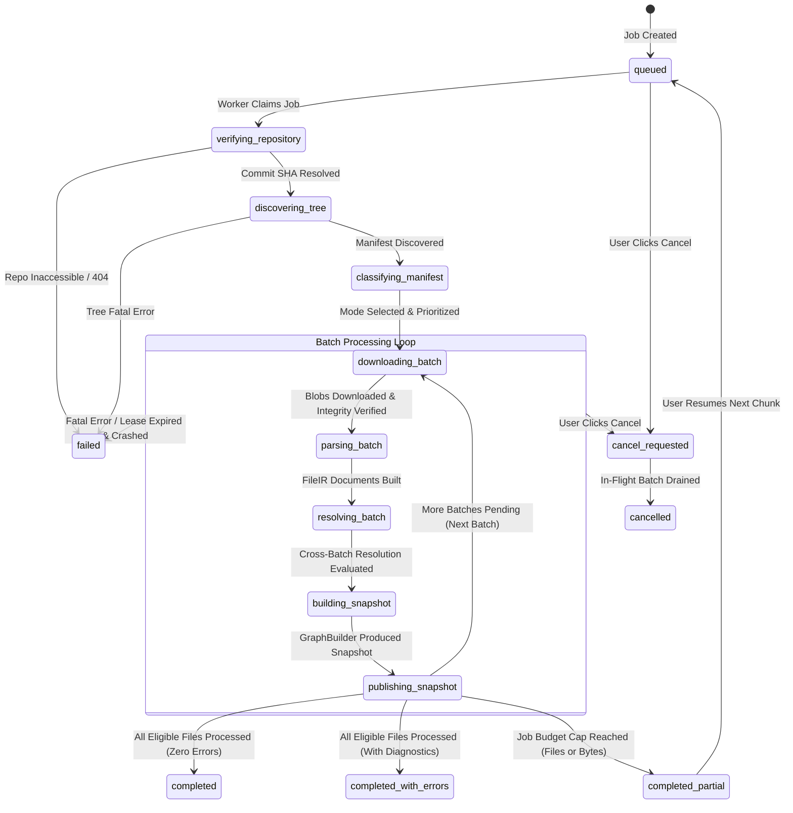

# Cartograph Phase 11 — Gate 11A Specification
## Ingestion Contract, Job Schema, and Resource Policy

**Document Type:** Architecture Contract & Implementation Specification  
**Status:** Approved for Gate 11A (Contract Design Only)  
**Implementation Boundary:** No production code, database migrations, dependency changes, or environment mutations are authorized during Gate 11A.  

---

# 1. Ingestion Job Lifecycle & State Machine

## 1.1 State Definitions
Every ingestion job progresses through explicit, deterministic lifecycle states. Generic states such as `processing` are prohibited.

| State | Category | Description |
|---|---|---|
| `queued` | Transient | Job record created and authorized; awaiting worker claim. |
| `verifying_repository` | Active Discovery | GitHub accessibility, visibility, and commit SHA resolution in progress. |
| `discovering_tree` | Active Discovery | Git Tree discovery and recursive manifest generation in progress. |
| `classifying_manifest` | Active Discovery | Path classification, exclusion filtering, and mode selection (`small`, `medium`, `large`). |
| `downloading_batch` | Batch Execution | Fetching Git blobs for the current batch using bounded concurrency. |
| `parsing_batch` | Batch Execution | Running language AST adapters and generating FileIR documents for the batch. |
| `resolving_batch` | Batch Execution | Running cross-batch resolvers against accumulated FileIR facts. |
| `building_snapshot` | Batch Execution | Constructing canonical nodes, confirmed edges, and unresolved references via `GraphBuilder`. |
| `publishing_snapshot` | Batch Execution | Validating graph via `GraphValidator` and publishing versioned snapshot to `GraphSnapshotStore`. |
| `completed` | Terminal Success | All eligible files analyzed with 100% success; graph status is `complete`. |
| `completed_with_errors` | Terminal Partial | All eligible files reached a terminal outcome, but some files had parser errors or diagnostics. |
| `completed_partial` | Terminal Budget Cap | Ingestion stopped cleanly due to configured file or byte budget cap. Graph is valid `partial`. |
| `failed` | Terminal Failure | Fatal unrecoverable error (e.g. repository deleted, GitHub API fatal 4xx). |
| `cancel_requested` | Transient Interruption | User requested cancellation; current batch is draining. |
| `cancelled` | Terminal Interruption | Job aborted by user; current accumulated snapshot published as `cancelled`. |

---

## 1.2 State Transition Diagram



---

## 1.3 Legal Transition Matrix
Any transition not explicitly allowed in this matrix is strictly illegal and will reject with `AppError(409, "ILLEGAL_JOB_STATE_TRANSITION")`.

| From State | Allowed Target States | Trigger / Guard |
|---|---|---|
| `queued` | `verifying_repository`, `cancel_requested`, `failed` | Worker claim (`SKIP LOCKED`) or user cancellation. |
| `verifying_repository` | `discovering_tree`, `failed`, `cancel_requested` | Commit resolved or verification failure. |
| `discovering_tree` | `classifying_manifest`, `failed`, `cancel_requested` | Git tree resolved or discovery failure. |
| `classifying_manifest` | `downloading_batch`, `completed_partial`, `failed`, `cancel_requested` | Files prioritized or zero eligible files. |
| `downloading_batch` | `parsing_batch`, `cancel_requested`, `failed` | Batch blobs fetched or network fatal. |
| `parsing_batch` | `resolving_batch`, `cancel_requested`, `failed` | FileIR batch completed. |
| `resolving_batch` | `building_snapshot`, `cancel_requested`, `failed` | Resolution pass finished. |
| `building_snapshot` | `publishing_snapshot`, `cancel_requested`, `failed` | Snapshot built. |
| `publishing_snapshot` | `downloading_batch`, `completed`, `completed_with_errors`, `completed_partial`, `cancel_requested`, `failed` | Graph validated; check remaining files. |
| `cancel_requested` | `cancelled` | Worker drains current batch and marks job cancelled. |
| `completed_partial` | `queued` | User clicks "Continue Ingestion" (resumption). |
| `completed` | *None (Terminal)* | Immutable. |
| `completed_with_errors` | *None (Terminal)* | Immutable. |
| `cancelled` | *None (Terminal)* | Immutable. |
| `failed` | *None (Terminal)* | Immutable. |

---

# 2. Database Schema & Concurrency Semantics

## 2.1 Table: `public.ingestion_jobs`
Stores repository-level ingestion job states, progress metrics, and lease ownership.

```sql
CREATE TABLE IF NOT EXISTS public.ingestion_jobs (
  id UUID PRIMARY KEY DEFAULT gen_random_uuid(),
  repository_id TEXT NOT NULL,
  organization_id TEXT NOT NULL REFERENCES public.organizations(id) ON DELETE CASCADE,
  commit_sha TEXT NOT NULL,
  mode TEXT NOT NULL CHECK (mode IN ('small', 'medium', 'large')),
  status TEXT NOT NULL CHECK (status IN (
    'queued', 'verifying_repository', 'discovering_tree', 'classifying_manifest',
    'downloading_batch', 'parsing_batch', 'resolving_batch', 'building_snapshot',
    'publishing_snapshot', 'completed', 'completed_with_errors', 'completed_partial',
    'failed', 'cancel_requested', 'cancelled'
  )),
  phase TEXT NOT NULL DEFAULT 'queued',
  fencing_token BIGINT NOT NULL DEFAULT 1,
  claimed_by TEXT,
  heartbeat_at TIMESTAMPTZ,
  total_files INT NOT NULL DEFAULT 0,
  processed_files INT NOT NULL DEFAULT 0,
  downloaded_files INT NOT NULL DEFAULT 0,
  parsed_files INT NOT NULL DEFAULT 0,
  failed_files INT NOT NULL DEFAULT 0,
  skipped_files INT NOT NULL DEFAULT 0,
  remaining_files INT NOT NULL DEFAULT 0,
  eligible_source_bytes BIGINT NOT NULL DEFAULT 0,
  downloaded_bytes BIGINT NOT NULL DEFAULT 0,
  confirmed_edges INT NOT NULL DEFAULT 0,
  unresolved_references INT NOT NULL DEFAULT 0,
  current_batch INT NOT NULL DEFAULT 0,
  total_batches INT NOT NULL DEFAULT 0,
  snapshot_version INT NOT NULL DEFAULT 0,
  initial_graph_ready BOOLEAN NOT NULL DEFAULT FALSE,
  graph_status TEXT NOT NULL DEFAULT 'none' CHECK (graph_status IN ('none', 'partial', 'complete')),
  termination_reason TEXT,
  created_at TIMESTAMPTZ NOT NULL DEFAULT NOW(),
  updated_at TIMESTAMPTZ NOT NULL DEFAULT NOW()
);

CREATE INDEX IF NOT EXISTS ingestion_jobs_claim_idx
  ON public.ingestion_jobs (status, heartbeat_at, created_at);

CREATE UNIQUE INDEX IF NOT EXISTS ingestion_jobs_active_unique_idx
  ON public.ingestion_jobs (repository_id, organization_id, commit_sha)
  WHERE status NOT IN ('completed', 'completed_with_errors', 'completed_partial', 'failed', 'cancelled');
```

---

## 2.2 Table: `public.ingestion_job_files`
Tracks file-level lifecycle, classification, priority rank, batch allocation, and error diagnostics.

```sql
CREATE TABLE IF NOT EXISTS public.ingestion_job_files (
  id UUID PRIMARY KEY DEFAULT gen_random_uuid(),
  job_id UUID NOT NULL REFERENCES public.ingestion_jobs(id) ON DELETE CASCADE,
  path TEXT NOT NULL,
  blob_sha TEXT NOT NULL,
  size_bytes BIGINT,
  category TEXT NOT NULL,
  language TEXT NOT NULL,
  priority_rank INT NOT NULL DEFAULT 4 CHECK (priority_rank BETWEEN 0 AND 4),
  status TEXT NOT NULL DEFAULT 'pending' CHECK (status IN (
    'pending', 'downloaded', 'parsed', 'skipped', 'failed'
  )),
  batch_number INT,
  error_code TEXT,
  error_message TEXT,
  created_at TIMESTAMPTZ NOT NULL DEFAULT NOW(),
  updated_at TIMESTAMPTZ NOT NULL DEFAULT NOW(),
  PRIMARY KEY (job_id, path)
);

CREATE INDEX IF NOT EXISTS ingestion_job_files_pending_idx
  ON public.ingestion_job_files (job_id, priority_rank, status);
```

---

## 2.3 Concurrency, Atomic Claiming, Leases & Fencing Tokens

### Atomic Claim Query (`FOR UPDATE SKIP LOCKED`)
Prevents race conditions when multiple worker processes or backend instances run concurrently:

```sql
UPDATE public.ingestion_jobs
SET status = 'verifying_repository',
    claimed_by = $workerId,
    fencing_token = fencing_token + 1,
    heartbeat_at = NOW(),
    updated_at = NOW()
WHERE id = (
  SELECT id FROM public.ingestion_jobs
  WHERE status = 'queued'
     OR (status NOT IN ('completed', 'completed_with_errors', 'completed_partial', 'failed', 'cancelled')
         AND heartbeat_at < NOW() - INTERVAL '60 seconds')
  ORDER BY created_at ASC
  LIMIT 1
  FOR UPDATE SKIP LOCKED
)
RETURNING *;
```

### Fencing Tokens (Zombie Worker Protection)
- Every worker holds `fencing_token` acquired during claim.
- Any state update or batch commit executes with `WHERE id = $jobId AND fencing_token = $myToken`.
- If worker $A$ experienced a 70-second event-loop freeze and worker $B$ reclaimed the lease (incrementing the token), worker $A$'s subsequent write affects 0 rows and aborts immediately. This guarantees that stale workers cannot corrupt progressive snapshots.

---

# 3. Repository & Eligible-File Classification

## 3.1 Mode Selection Policy

$$\text{eligibleSourceBytes} = \sum_{\text{eligible files}} \text{file.size}$$

| Mode | Threshold Rule | Ingestion Strategy |
|---|---|---|
| **Small / Complete** | $\text{eligibleFileCount} \le 200 \text{ AND } \text{eligibleSourceBytes} \le 150\text{ MB}$ | Single-job complete ingestion. Processed in chunks of up to 100 files; publishes initial graph after Batch 1. |
| **Medium / Progressive** | $\text{eligibleFileCount} > 200 \text{ OR } \text{eligibleSourceBytes} > 150\text{ MB}$ | Batch 1: 100 files (initial graph publication). Subsequent batches: 50–100 files continuous. |
| **Large / Adaptive Progressive** | $\text{eligibleFileCount} \ge 500 \text{ OR } \text{eligibleSourceBytes} \ge 300\text{ MB}$ | Batch 1: 100 files. Adaptive batch sizing (down to 25 files based on memory/parse cost); strict rate pacing. |

*Note: Large mode takes precedence over medium.*

---

## 3.2 File Priority Ranks (Deterministic Architectural Ordering)
Files are never processed alphabetically. They are sorted deterministically by `(priority_rank ASC, path ASC)`:

| Rank | Architectural Value | Patterns & Filenames |
|---|---|---|
| **P0** | Project Identity & Config | `README*`, `package.json`, `tsconfig*.json`, `pyproject.toml`, `pom.xml`, `CMakeLists.txt`, `Makefile` |
| **P1** | Entry Points & Server Bootstrap | `index.*`, `main.*`, `app.*`, `server.*`, `src/index.*`, `src/main.*`, `src/App.*` |
| **P2** | Routing, APIs & Controllers | `*controller*`, `*route*`, `*api*`, `*service*`, `*client*`, `*router*` |
| **P3** | Core Domain & Models | `*model*`, `*entity*`, `*schema*`, `*types*`, `*domain*`, `*store*` |
| **P4** | Remaining Source Files | All other eligible language files |

---

## 3.3 Exclusion Categories & Reasons
Git tree metadata is retained for all repository files; content download is skipped for non-source entries:

| Category | Typical Extensions / Paths | Exclusion Reason Code |
|---|---|---|
| Media Assets | `.png`, `.jpg`, `.jpeg`, `.gif`, `.svg`, `.ico`, `.webp`, `.mp4`, `.mp3` | `media_asset` |
| Document Assets | `.pdf`, `.doc`, `.docx`, `.xls`, `.xlsx`, `.ppt`, `.pptx` | `document_asset` |
| Binary Executables | `.exe`, `.dll`, `.so`, `.dylib`, `.bin` | `binary_executable` |
| Compiled Output | `.class`, `.pyc`, `.pyo`, `.o`, `.obj`, `.wasm` | `compiled_artifact` |
| Vendored Dependencies | `node_modules/`, `vendor/`, `third_party/`, `.venv/` | `vendored_dependency` |
| Build & Dist Output | `dist/`, `build/`, `out/`, `target/`, `.next/`, `bundle*.js` | `build_output` |
| Oversized Source | Any source file $> 1,000,000\text{ bytes}$ | `oversized` |

---

# 4. Resource Budgets & Safety Limits

| Limit Dimension | Provisional Value | Operational Justification & Benchmarking |
|---|---|---|
| **Manifest Discovery Limit** | 10,000 entries | Maximum Git Tree items parsed in Phase 03 without non-recursive fallback. |
| **Per-File Size Limit** | $1\text{ MB}$ ($1,000,000\text{ B}$) | Hard cap. Larger files are skipped with reason `oversized` to prevent parser event-loop freezes. |
| **Batch Size Cap (Files)** | 100 files (Batch 1), 50–100 files (later) | Guarantees rapid initial graph publication ($\le 5\text{ seconds}$). |
| **Batch Size Cap (Bytes)** | $8\text{ MB}$ raw source text | Prevents in-flight V8 heap spike from exceeding $\sim 150\text{ MB}$ during AST creation. |
| **Job Aggregate Budget (Files)** | 1,500 files | Prototype limit. If repo $> 1,500$ files, transitions to `completed_partial`. |
| **Job Aggregate Budget (Bytes)** | $30\text{ MB} - 50\text{ MB}$ (provisional) | Safe ceiling for memory-bounded prototype. Will be adjusted after Gate 11H memory benchmarks. |
| **Download Concurrency** | 6 workers | Optimized for GitHub REST API blob fetching without triggering secondary abuse limits. |
| **Parser Concurrency** | 4 workers | Keeps CPU load bounded to prevent starving the Express event loop. |
| **AST File Parse Timeout** | $5,000\text{ ms}$ | Cooperative timeout via `withTimeout`. Rejects with `PARSER_TIMEOUT`. |
| **Worker Lease Expiration** | $60,000\text{ ms}$ | Dead worker detection threshold for crash recovery. |
| **Worker Heartbeat Interval** | $15,000\text{ ms}$ | Heartbeat cadence written to `ingestion_jobs.heartbeat_at`. |
| **Transient Retries** | 1 attempt | Bounded backoff for transient 503/504 network errors; 0 retries on 4xx. |

---

# 5. Progress Event Schema & Exact Counting Semantics

## 5.1 SSE Event Schema (`event: progress`)

```json
{
  "jobId": "3fa85f64-5717-4562-b3fc-2c963f66afa6",
  "repositoryId": "adrianhajdin/cartograph",
  "commitSha": "d41d8cd98f00b204e9800998ecf8427e00000000",
  "status": "parsing_batch",
  "phase": "parsing_batch",
  "mode": "progressive",
  "totalFiles": 1240,
  "processedFiles": 250,
  "downloadedFiles": 250,
  "parsedFiles": 245,
  "failedFiles": 2,
  "skippedFiles": 3,
  "remainingFiles": 990,
  "eligibleSourceBytes": 45200100,
  "downloadedBytes": 9800000,
  "confirmedEdges": 84,
  "unresolvedReferences": 19,
  "progressPercentage": 20.16,
  "initialGraphReady": true,
  "graphStatus": "partial",
  "currentBatch": 3,
  "totalBatches": 13,
  "snapshotVersion": 3,
  "message": "Analyzing Batch 3 (50 files)...",
  "timestamp": "2026-11-13T22:45:00.000Z"
}
```

## 5.2 Counting Invariants & Derivations
- `totalFiles`: Invariant count of eligible source files in the job manifest ($N_{\text{eligible}}$).
- `processedFiles = parsedFiles + failedFiles + skippedFiles` (Files in a terminal state for this job).
- `remainingFiles = totalFiles - processedFiles`.
- `confirmedEdges`: Count of confirmed dependency edges in the currently published graph snapshot.
- `unresolvedReferences`: Count of unresolved/ambiguous facts in the snapshot (strictly excluded from confirmed edges).
- `progressPercentage`:
  $$\text{progressPercentage} = \min\left(100, \frac{\text{processedFiles}}{\text{totalFiles}} \times 100\right)$$
  *Invariant: $\text{progressPercentage} = 100.00$ occurs if and only if status is `completed`, `completed_with_errors`, or `completed_partial`.*

---

# 6. Graph Snapshot Versioning & 5D Cache Integration

## 6.1 Preserving Canonical Identities
- Node IDs: `${repositoryId}@${commitSha}:${path}` for files; `${fileNodeId}#${symbolId}` for symbols; `external:${ecosystem}:${pkg}` for externals.
- Edge IDs: `${sourceId} -[${type}]-> ${targetId}`.
- Canonical IDs **never change** across progressive batches.

## 6.2 5D Cache Key & Monotonic Snapshot Versions
- Existing 5D cache key:
  `cartograph:graph:${repositoryId}:${commitSha}:bld_${builderVersion}:ir_${fileIrVersion}:rf_${resolverFingerprint}`
- **Integration Rule:**
  - The 5D key represents the active cache slot for the repository revision.
  - The cached record carries:
    ```javascript
    {
      snapshot,
      queryService,
      snapshotVersion: 1, // increments: 1, 2, 3...
      graphStatus: "partial", // transitions: "partial" -> "complete"
      isComplete: false
    }
    ```
  - When Batch $N+1$ produces an updated snapshot:
    1. `GraphValidator.validate(newSnapshot)` passes.
    2. Old query indexes are explicitly released via `_releaseEntry()`.
    3. The cache entry is updated with the new snapshot, new `GraphQueryService`, incremented `snapshotVersion: N + 1`, and updated `accessSeq`.
    4. Client requests passing `?version=N` receive the new version; stale versions are never served as complete.

---

# 7. Fetch-Based Authenticated SSE Contract

## 7.1 Server Endpoint: `GET /api/repositories/:repositoryId/graph/jobs/:jobId/events`
- Headers:
  - `Content-Type: text/event-stream`
  - `Cache-Control: no-cache`
  - `Connection: keep-alive`
  - `X-Accel-Buffering: no` (disables reverse-proxy buffering)
- Authentication:
  - Validates Clerk JWT in `Authorization: Bearer <token>`.
  - Validates active organization in `x-organization-id: orgId`.
  - Authorizes repository ownership via `verifyRepositoryOwnership(repositoryId, orgId)`.

## 7.2 Framing, Reconnects & Heartbeats
- **Framing:**
  ```text
  id: 42
  event: progress
  data: {"jobId":"...","processedFiles":250,"progressPercentage":20.16,...}

  : keep-alive
  ```
- **Heartbeat:** Sent every $15\text{ seconds}$ as an SSE comment (`: keep-alive\n\n`) to prevent proxy timeout.
- **Client Reconnection:** The frontend passes `Last-Event-ID: 42`. The server sends the current job state immediately upon reconnection.

---

# 8. Cancellation, Recovery & Partial Continuation

## 8.1 Cancellation (`POST .../graph/jobs/:jobId/cancel`)
1. User clicks Cancel in UI.
2. Endpoint verifies tenant authorization and sets `status = 'cancel_requested'`.
3. Active worker checks status before starting the next batch, drains current batch, sets `status = 'cancelled'`, and publishes the accumulated snapshot as `cancelled`.

## 8.2 Restart Recovery (`reconcileDanglingJobs`)
1. On backend server boot, `IngestionJobManager.reconcileDanglingJobs()` executes.
2. Scans for jobs with `status NOT IN ('completed', 'completed_with_errors', 'completed_partial', 'failed', 'cancelled') AND heartbeat_at < NOW() - INTERVAL '60 seconds'`.
3. Marks them `failed` with `termination_reason: 'backend_restarted_during_execution'`.

## 8.3 Partial Continuation (`POST .../graph/jobs/:jobId/resume`)
1. If a job stops at `completed_partial` due to budget limit ($1,500\text{ files}$):
2. User clicks **"Continue Ingestion (Next 500 Files)"**.
3. Re-claims the job, sets `status = 'queued'`, and processes the next prioritized batch from `ingestion_job_files` where `status = 'pending'`.
4. Increments snapshot version ($v_{\text{prev}} + 1$), seamlessly updating the live React Flow graph.

---

# 9. Acceptance Criteria & Test Plan for Gate 11A

### Gate 11A Verification Plan
1. **State Machine Integrity:**
   - Test every legal state transition.
   - Verify that illegal state transitions throw `409 ILLEGAL_JOB_STATE_TRANSITION`.
2. **Fencing Token & Leases:**
   - Verify that a stale worker with an outdated fencing token cannot update job state.
   - Verify atomic claim using simulated concurrent workers.
3. **Classification & Prioritization:**
   - Verify mode selection: $\le 200\text{ files} \rightarrow \text{small}$, $> 200 \rightarrow \text{medium}$, $\ge 500 \rightarrow \text{large}$.
   - Verify P0 to P4 priority sorting (`index.*` before `utils.*`).
   - Verify exclusion classification for media, documents, and binaries.
4. **SSE Event Formatting:**
   - Verify JSON progress envelope calculation and invariant: `processedFiles = parsed + failed + skipped`.
   - Verify `remainingFiles` never becomes negative.
   - Verify progress percentage never reaches $100\%$ on partial completion.

---

# 10. Unresolved Decisions Requiring Approval

1. **Database Migration Timing:**
   - *Recommendation:* Create migration `002_phase11_ingestion_jobs.sql` in Gate 11B when implementing `IngestionJobManager.js`.
2. **Provisional Aggregate Budget:**
   - *Recommendation:* Keep the provisional budget at **$30\text{ MB} - 50\text{ MB}$ / $1,500\text{ files}$** for the initial implementation, and benchmark V8 heap consumption in Gate 11H before expanding to $150\text{ MB}$.
3. **Polling Fallback:**
   - *Recommendation:* Implement `GET /api/repositories/:id/graph/jobs/:jobId` polling (every $1,500\text{ ms}$) as a fallback in the frontend if the SSE stream encounters persistent network disconnects.

---

**Gate 11A contracts and specifications are complete.**  
No code, migrations, or dependencies have been modified. Awaiting approval before proceeding to Gate 11B.

