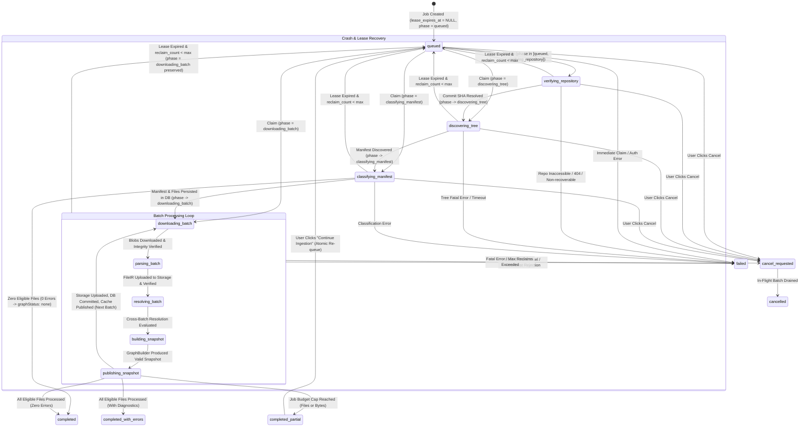
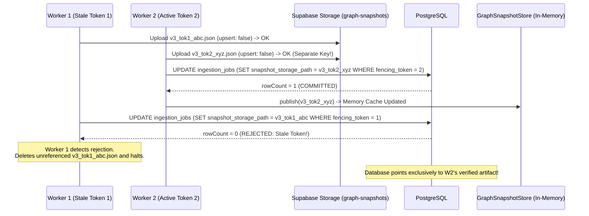

# Cartograph Phase 11 — Gate 11A Specification
## Ingestion Contract, Job Schema, and Resource Policy (Final Blocker Resolution)

**Document Type:** Architecture Contract & Implementation Specification  
**Status:** Approved for Gate 11A (Contract Design Only — Final Blocker Resolution)  
**Implementation Boundary:** No production code, database migrations, dependency changes, or environment mutations are authorized during Gate 11A.  

---

# 1. Ingestion Job Lifecycle & State Machine

## 1.1 State Definitions (15 Lifecycle States)
Every ingestion job progresses through explicit, deterministic lifecycle states. Generic states such as `processing` are prohibited:

| State | Category | Description |
|---|---|---|
| `queued` | Transient Initial | Job record created and authorized; awaiting worker claim via atomic `SKIP LOCKED`. Also the landing state for reclaimed interrupted jobs. |
| `verifying_repository` | Active Discovery | GitHub accessibility, visibility, and target commit SHA resolution in progress. |
| `discovering_tree` | Active Discovery | Git Tree discovery and recursive manifest generation in progress. |
| `classifying_manifest` | Active Discovery | Path classification, exclusion filtering, mode selection (`small`, `medium`, `large`), and strategy assignment. |
| `downloading_batch` | Batch Execution | Fetching Git blobs for the current prioritized batch using bounded concurrency. |
| `parsing_batch` | Batch Execution | Running language AST adapters and generating FileIR documents for the current batch. |
| `resolving_batch` | Batch Execution | Running cross-batch symbol and import resolvers against accumulated FileIR facts. |
| `building_snapshot` | Batch Execution | Constructing canonical nodes, confirmed edges, and unresolved references via `GraphBuilder`. |
| `publishing_snapshot` | Batch Execution | Validating graph via `GraphValidator` and publishing versioned snapshot to durable storage and `GraphSnapshotStore`. |
| `completed` | Terminal Success | All eligible files analyzed with 100% success (or 0 eligible files with 0 errors); graph status is `complete` (or `none` if 0 eligible files). |
| `completed_with_errors` | Terminal Partial | All eligible files reached a terminal outcome, but some files had parser errors or diagnostics. Graph status is `complete`. |
| `completed_partial` | Terminal Budget Cap | Ingestion stopped cleanly due to configured file or byte budget cap. Graph status is valid `partial`. |
| `failed` | Terminal Failure | Fatal unrecoverable error (e.g. repository deleted, GitHub API fatal 4xx, lease reclaim limit exceeded). |
| `cancel_requested` | Transient Interruption | User requested cancellation; active worker detects this on heartbeat or batch boundary and drains/aborts. |
| `cancelled` | Terminal Interruption | Job aborted by user. Current batch drained; graph status remains `partial` (if Batch 1+ was published) or `none`. |

---

## 1.2 Explicit Field Semantics

1. **`status` (Active Runtime State):**
   - The immediate operational state of the job (`downloading_batch`, `parsing_batch`, `cancel_requested`, etc.). Flaps as execution moves between batch sub-steps.
2. **`phase` (Durable Execution Milestone Checkpoint):**
   - Represents the last durably committed milestone in PostgreSQL.
   - Allowed values: `'queued'`, `'verifying_repository'`, `'discovering_tree'`, `'classifying_manifest'`, `'downloading_batch'`, `'completed'`, `'completed_with_errors'`, `'completed_partial'`, `'failed'`, `'cancelled'`.
   - Does **not** flap during transient sub-steps (`parsing_batch`, `resolving_batch`, `building_snapshot`). Once the manifest is persisted into `ingestion_job_files`, `phase` remains `'downloading_batch'` until a terminal milestone is reached.
3. **`last_committed_batch` (Authoritative Committed Batch Identifier):**
   - The highest batch number whose files, cross-batch resolution, and snapshot were durably committed in PostgreSQL. Starts at 0. Increments monotonically ($1, 2, 3\dots$) upon successful batch transaction commit.
4. **`snapshot_version` (Authoritative Committed Snapshot Version):**
   - The monotonic snapshot version committed in PostgreSQL. Starts at 0. Increments to $1, 2, 3\dots$ only when both the immutable storage artifact is uploaded and the database batch transaction commits.
5. **Graph Snapshot Durability vs. Cache Availability:**
   - **Durable Storage (Cold):** Immutable artifacts in Supabase Storage (`graph-snapshots/...`) referenced by PostgreSQL (`snapshot_storage_path`, `snapshot_sha256`). Survives container restarts and memory wipes.
   - **Cache Availability (Hot):** In-memory LRU cache in `GraphSnapshotStore` with pre-computed query indexes (`GraphQueryService`). On a cache miss or after restart, the cache is lazily rehydrated from durable Supabase Storage.

---

## 1.3 State Transition & Recovery Diagram



---

## 1.4 Complete Recovery Phase Matrix
Defines exact recovery semantics for every active phase when a worker crashes, loses its lease, or encounters an unhandled exception:

| Interrupted Active State (`status`) | Durable Milestone (`phase`) | Operations that MUST be repeated | Operations that MUST NOT be repeated | Required File-Level Rollback | Next State upon Claim |
|---|---|---|---|---|---|
| `verifying_repository` | `'queued'` / `'verifying_repository'` | GitHub repo access check and commit SHA resolution. | None. | None (no file records exist). | `verifying_repository` |
| `discovering_tree` | `'discovering_tree'` | Git Tree recursive discovery via GitHub API. | Commit SHA resolution (reused). | None. | `discovering_tree` |
| `classifying_manifest` | `'classifying_manifest'` | Manifest classification, language filtering, priority ranking, and `ingestion_job_files` population. | Git Tree discovery (tree cached in memory or fetched once). | `DELETE FROM public.ingestion_job_files WHERE job_id = $jobId` (removes incomplete inserts). | `classifying_manifest` |
| `downloading_batch` | `'downloading_batch'` | Download Git blobs for pending batch files. | Manifest discovery, classification, and all earlier committed batches ($1 \dots B_{\text{committed}}$). | Reset current batch files where `status = 'downloaded'` back to `status = 'pending'`. | `downloading_batch` |
| `parsing_batch` | `'downloading_batch'` | Re-download blobs for interrupted batch and re-execute AST parsers into FileIR. | Manifest discovery, classification, and earlier committed batches ($1 \dots B_{\text{committed}}$). | Reset current batch files where `status = 'downloaded'` back to `status = 'pending'`. Delete orphaned staging FileIR artifacts. | `downloading_batch` |
| `resolving_batch` | `'downloading_batch'` | Re-run cross-batch symbol and import resolvers across accumulated durable FileIR facts. | Manifest discovery, classification, and parsing of previous batches. | Reset uncommitted batch files back to `status = 'pending'`. | `downloading_batch` |
| `building_snapshot` | `'downloading_batch'` | Construct snapshot using `GraphBuilder` from accumulated durable FileIR. | Re-parsing earlier batches. | Reset uncommitted batch files back to `status = 'pending'`. | `downloading_batch` |
| `publishing_snapshot` | `'downloading_batch'` | If DB commit succeeded before crash: advance to next batch. If DB commit did not succeed: re-execute resolution and snapshot build. | Re-parsing earlier batches ($1 \dots B_{\text{committed}}$). | If DB commit succeeded: None. If DB commit failed: reset current batch uncommitted files to `status = 'pending'`. | `downloading_batch` |

---

# 2. Database Schema & Durable State Tracking

## 2.1 Table: `public.ingestion_jobs`
Stores repository-level ingestion job states, progress metrics, operational limits, durable artifact references, lease ownership, and fencing tokens.

```sql
CREATE TABLE IF NOT EXISTS public.ingestion_jobs (
  id UUID PRIMARY KEY DEFAULT gen_random_uuid(),
  repository_id TEXT NOT NULL,
  organization_id TEXT NOT NULL REFERENCES public.organizations(id) ON DELETE CASCADE,
  commit_sha TEXT NOT NULL,
  mode TEXT NOT NULL CHECK (mode IN ('small', 'medium', 'large')),
  ingestion_strategy TEXT NOT NULL DEFAULT 'continuous_progressive' CHECK (
    ingestion_strategy IN ('single_pass', 'continuous_progressive', 'adaptive_progressive')
  ),
  status TEXT NOT NULL CHECK (status IN (
    'queued', 'verifying_repository', 'discovering_tree', 'classifying_manifest',
    'downloading_batch', 'parsing_batch', 'resolving_batch', 'building_snapshot',
    'publishing_snapshot', 'completed', 'completed_with_errors', 'completed_partial',
    'failed', 'cancel_requested', 'cancelled'
  )),
  phase TEXT NOT NULL DEFAULT 'queued' CHECK (phase IN (
    'queued', 'verifying_repository', 'discovering_tree', 'classifying_manifest',
    'downloading_batch', 'completed', 'completed_with_errors', 'completed_partial',
    'failed', 'cancelled'
  )),
  fencing_token BIGINT NOT NULL DEFAULT 1,
  claimed_by TEXT,
  heartbeat_at TIMESTAMPTZ,
  lease_expires_at TIMESTAMPTZ,
  reclaim_count INT NOT NULL DEFAULT 0,
  max_reclaims INT NOT NULL DEFAULT 3,
  
  -- Manifest Durability Columns
  root_tree_sha TEXT,
  manifest_storage_path TEXT,
  manifest_sha256 TEXT,
  
  -- Progress and Batch Tracking Columns
  last_committed_batch INT NOT NULL DEFAULT 0,
  current_batch INT NOT NULL DEFAULT 0,
  total_batches INT NOT NULL DEFAULT 0,
  total_files INT NOT NULL DEFAULT 0,
  processed_files INT NOT NULL DEFAULT 0,
  downloaded_files INT NOT NULL DEFAULT 0,
  parsed_files INT NOT NULL DEFAULT 0,
  failed_files INT NOT NULL DEFAULT 0,
  skipped_files INT NOT NULL DEFAULT 0,
  remaining_files INT NOT NULL DEFAULT 0,
  eligible_source_bytes BIGINT NOT NULL DEFAULT 0,
  downloaded_bytes BIGINT NOT NULL DEFAULT 0,
  confirmed_edges INT NOT NULL DEFAULT 0,
  unresolved_references INT NOT NULL DEFAULT 0,
  
  -- Immutable Snapshot Pointer Columns
  snapshot_version INT NOT NULL DEFAULT 0,
  snapshot_storage_path TEXT,
  snapshot_sha256 TEXT,
  snapshot_bytes BIGINT,
  initial_graph_ready BOOLEAN NOT NULL DEFAULT FALSE,
  graph_status TEXT NOT NULL DEFAULT 'none' CHECK (graph_status IN ('none', 'partial', 'complete')),
  termination_reason TEXT,
  created_at TIMESTAMPTZ NOT NULL DEFAULT NOW(),
  updated_at TIMESTAMPTZ NOT NULL DEFAULT NOW()
);

-- Index for atomic claiming and authoritative lease expiration scans
CREATE INDEX IF NOT EXISTS ingestion_jobs_claim_idx
  ON public.ingestion_jobs (status, lease_expires_at, created_at);

-- Prevents duplicate concurrent active ingestion jobs for the same repository revision
CREATE UNIQUE INDEX IF NOT EXISTS ingestion_jobs_active_unique_idx
  ON public.ingestion_jobs (repository_id, organization_id, commit_sha)
  WHERE status NOT IN ('completed', 'completed_with_errors', 'completed_partial', 'failed', 'cancelled');
```

---

## 2.2 Table: `public.ingestion_job_files`
Tracks file-level lifecycle, classification, priority rank, durable FileIR artifact storage references, and error diagnostics.

```sql
CREATE TABLE IF NOT EXISTS public.ingestion_job_files (
  id UUID PRIMARY KEY DEFAULT gen_random_uuid(),
  job_id UUID NOT NULL REFERENCES public.ingestion_jobs(id) ON DELETE CASCADE,
  path TEXT NOT NULL,
  blob_sha TEXT NOT NULL,
  size_bytes BIGINT,
  category TEXT NOT NULL,
  language TEXT NOT NULL,
  priority_rank INT NOT NULL DEFAULT 4 CHECK (priority_rank BETWEEN 0 AND 4),
  status TEXT NOT NULL DEFAULT 'pending' CHECK (status IN (
    'pending', 'downloaded', 'parsed', 'skipped', 'failed'
  )),
  batch_number INT,
  file_ir_storage_path TEXT,
  file_ir_sha256 TEXT,
  file_ir_bytes INT,
  file_ir_version TEXT DEFAULT '1.0.0',
  parser_fingerprint TEXT,
  error_code TEXT,
  error_message TEXT,
  created_at TIMESTAMPTZ NOT NULL DEFAULT NOW(),
  updated_at TIMESTAMPTZ NOT NULL DEFAULT NOW(),
  CONSTRAINT uq_ingestion_job_files_job_path UNIQUE (job_id, path)
);

CREATE INDEX IF NOT EXISTS ingestion_job_files_pending_idx
  ON public.ingestion_job_files (job_id, priority_rank, status);

CREATE INDEX IF NOT EXISTS ingestion_job_files_parsed_ir_idx
  ON public.ingestion_job_files (job_id, status)
  WHERE status = 'parsed';
```

---

## 2.3 Valid PostgreSQL Claim & Reconciliation SQL

### 2.3.1 Atomic Worker Claim with Phase Mapping
```sql
BEGIN;

WITH claimable_job AS (
  SELECT id, phase
  FROM public.ingestion_jobs
  WHERE status = 'queued'
     OR (
       status NOT IN ('completed', 'completed_with_errors', 'completed_partial', 'failed', 'cancelled')
       AND (
         lease_expires_at <= NOW()
         OR (lease_expires_at IS NULL AND created_at < NOW() - INTERVAL '60 seconds')
       )
     )
  ORDER BY created_at ASC
  LIMIT 1
  FOR UPDATE SKIP LOCKED
)
UPDATE public.ingestion_jobs j
SET status = CASE 
      WHEN c.phase = 'downloading_batch' THEN 'downloading_batch'
      WHEN c.phase = 'classifying_manifest' THEN 'classifying_manifest'
      WHEN c.phase = 'discovering_tree' THEN 'discovering_tree'
      ELSE 'verifying_repository'
    END,
    claimed_by = $workerId,
    fencing_token = j.fencing_token + 1,
    heartbeat_at = NOW(),
    lease_expires_at = NOW() + INTERVAL '60 seconds',
    updated_at = NOW()
FROM claimable_job c
WHERE j.id = c.id
RETURNING j.*;

COMMIT;
```

### 2.3.2 Valid Single-Statement Reconciliation SQL (`reconcileDanglingJobs`)
```sql
BEGIN;

WITH expired_jobs AS (
  SELECT id, reclaim_count, max_reclaims, phase
  FROM public.ingestion_jobs
  WHERE status NOT IN ('completed', 'completed_with_errors', 'completed_partial', 'failed', 'cancelled')
    AND (
      lease_expires_at <= NOW()
      OR (lease_expires_at IS NULL AND created_at < NOW() - INTERVAL '60 seconds')
    )
  ORDER BY created_at ASC
  FOR UPDATE SKIP LOCKED
),
failed_updates AS (
  UPDATE public.ingestion_jobs j
  SET status = 'failed',
      phase = 'failed',
      termination_reason = 'lease_reclaim_limit_exceeded',
      updated_at = NOW()
  FROM expired_jobs e
  WHERE j.id = e.id AND e.reclaim_count >= e.max_reclaims
  RETURNING j.id
),
reclaimed_jobs AS (
  UPDATE public.ingestion_jobs j
  SET status = 'queued',
      claimed_by = NULL,
      heartbeat_at = NULL,
      lease_expires_at = NULL,
      reclaim_count = j.reclaim_count + 1,
      fencing_token = j.fencing_token + 1,
      updated_at = NOW()
  FROM expired_jobs e
  WHERE j.id = e.id 
    AND e.reclaim_count < e.max_reclaims
    AND j.id NOT IN (SELECT id FROM failed_updates)
  RETURNING j.id
)
UPDATE public.ingestion_job_files f
SET status = 'pending',
    batch_number = NULL,
    file_ir_storage_path = NULL,
    file_ir_sha256 = NULL,
    file_ir_bytes = NULL,
    error_code = NULL,
    error_message = NULL,
    updated_at = NOW()
WHERE f.job_id IN (SELECT id FROM reclaimed_jobs)
  AND (f.status = 'downloaded' OR (f.batch_number IS NOT NULL AND f.batch_number > (
    SELECT last_committed_batch FROM public.ingestion_jobs WHERE id = f.job_id
  )));

COMMIT;
```

---

# 3. Manifest Durability & Atomic Persistence

## 3.1 Preserving Manifest and Discovery Integrity
Memory does not survive process restarts. To ensure Git Tree discovery is never repeated unnecessarily and manifest integrity is verified:
1. **GitHub Ref Resolution:** `resolveCommitAndRootTree(owner, repo, ref)` returns authoritative `{ commitSha, rootTreeSha }`.
2. **Raw Manifest Storage Backup:**
   The raw Git tree entries discovered by `generateManifest()` are serialized to JSON and uploaded to Supabase Storage:
   - Path: `${orgId}/${repoId}/${commitSha}/manifest/tree_${rootTreeSha}.json`
   - Checksum: SHA-256 computed on the tree JSON buffer (`manifest_sha256`).
3. **Manifest Authoritative Verification:**
   Before persisting, the worker verifies that the raw manifest buffer matches `manifest_sha256` and that every classified file belongs strictly to `root_tree_sha` and `commitSha`.
4. **Atomic Manifest Persistence Transaction:**
   Before transitioning `phase` to `'downloading_batch'`, the worker writes the classified manifest into PostgreSQL inside an atomic transaction:

```sql
BEGIN;

-- 1. Insert all eligible classified files in bulk
INSERT INTO public.ingestion_job_files (
  job_id, path, blob_sha, size_bytes, category, language, priority_rank, status
)
VALUES
  ($jobId, $path1, $blobSha1, $size1, $cat1, $lang1, $rank1, 'pending'),
  ($jobId, $path2, $blobSha2, $size2, $cat2, $lang2, $rank2, 'pending')
  -- [All eligible manifest files]
ON CONFLICT (job_id, path) DO UPDATE
SET blob_sha = EXCLUDED.blob_sha,
    size_bytes = EXCLUDED.size_bytes,
    priority_rank = EXCLUDED.priority_rank;

-- 2. Transition phase to downloading_batch with immutable root_tree_sha
UPDATE public.ingestion_jobs
SET phase = 'downloading_batch',
    status = 'downloading_batch',
    root_tree_sha = $rootTreeSha,
    manifest_storage_path = $manifestPath,
    manifest_sha256 = $manifestSha256,
    total_files = $eligibleFileCount,
    remaining_files = $eligibleFileCount,
    eligible_source_bytes = $eligibleSourceBytes,
    mode = $mode,
    ingestion_strategy = $strategy,
    total_batches = CEIL($eligibleFileCount::NUMERIC / 100),
    updated_at = NOW()
WHERE id = $jobId
  AND fencing_token = $myFencingToken
  AND claimed_by = $workerId
  AND phase IN ('verifying_repository', 'discovering_tree', 'classifying_manifest');

COMMIT;
```

## 3.2 Recovery without Repeated GitHub Discovery
- If a crash occurs before this transaction commits: `phase` remains `discovering_tree` or `classifying_manifest`. The reclaimed worker executes `DELETE FROM public.ingestion_job_files WHERE job_id = $jobId AND status = 'pending'` and safely re-runs classification.
- If a crash occurs **after** this transaction commits: `phase = 'downloading_batch'`.
- The reclaiming worker verifies `COUNT(*) FROM ingestion_job_files WHERE job_id = $jobId` matches `total_files`.
- **The GitHub Tree API is NEVER queried again.** All canonical paths, blob SHAs, priority ranks, and batch schedules are read directly from PostgreSQL.

---

# 4. FileIR Persistence & Atomic Multi-Row Batch Commit

## 4.1 Storage Architecture: Content-Addressed Immutable FileIR
FileIR documents (FileIR v1.0.0 schema unchanged) are written to Supabase Storage bucket `fileir-artifacts`:
- **Object Key Structure:**
  `${organizationId}/${repositoryId}/${commitSha}/fileir/${filePath}_${blobSha}_${fullFileIrSha256}.fileir.json`
- Each artifact is **content-addressed, immutable, and uses the full 64-character SHA-256 hash**.
- **Compatibility & Fingerprinting:**
  - Along with `file_ir_version = '1.0.0'`, the table stores `parser_fingerprint` representing language adapter version and parser configuration.
  - An existing artifact is reused if and only if its full SHA-256 matches and its `parser_fingerprint` matches the current environment.

## 4.2 Two-Phase Batch Commit Protocol

### Phase 1: Storage Upload & Integrity Verification
For each file in the batch (e.g. 50 files):
1. AST parser produces `fileIrDocument` (FileIR v1.0.0).
2. Worker serializes JSON to UTF-8 buffer and computes full 64-character SHA-256 hash.
3. Worker uploads to Supabase Storage with immutable semantics:
   ```javascript
   const { error } = await supabaseAdmin.storage
     .from('fileir-artifacts')
     .upload(storagePath, buffer, { contentType: 'application/json', upsert: false });
   ```
4. Worker tracks uploaded artifacts in `uploadedStagingList: Array<{ path, storagePath, sha256, bytes, parserFingerprint }>`.
- **Partial Upload Cleanup:** If an upload fails midway through the batch (e.g. file 32 of 50 fails), the worker catches the error, calls `supabaseAdmin.storage.from('fileir-artifacts').remove(uploadedStagingList.map(a => a.storagePath))`, and aborts. The database is never touched.

### Phase 2: Atomic Multi-Row Database Commit
Only when **ALL** files in the batch are verified in Supabase Storage does the worker execute the multi-row batch commit in PostgreSQL.
The transaction strictly verifies:
- Fencing token and worker ownership match.
- Worker lease is still valid (`lease_expires_at > NOW()`).
- Expected number of file rows were updated (`files_updated = $expectedBatchCount`).
- Job update succeeded (`job_updated = 1`).
- If any condition fails, the entire transaction is rolled back; FileIR records never become committed if the batch/snapshot commit is rejected.

```sql
BEGIN;

WITH updated_files AS (
  UPDATE public.ingestion_job_files f
  SET status = 'parsed',
      batch_number = $currentBatch,
      file_ir_storage_path = v.storage_path,
      file_ir_sha256 = v.sha256,
      file_ir_bytes = v.bytes,
      file_ir_version = '1.0.0',
      parser_fingerprint = v.parser_fingerprint,
      updated_at = NOW()
  FROM (VALUES
    ($path1, $storagePath1, $fullSha256_1, $bytes1, $fingerprint1),
    ($path2, $storagePath2, $fullSha256_2, $bytes2, $fingerprint2)
    -- [All files in current batch]
  ) AS v(path, storage_path, sha256, bytes, parser_fingerprint)
  WHERE f.job_id = $jobId
    AND f.path = v.path
    AND f.status = 'downloaded'
  RETURNING f.id
),
updated_job AS (
  UPDATE public.ingestion_jobs
  SET last_committed_batch = $currentBatch,
      current_batch = $currentBatch,
      snapshot_version = $newSnapshotVersion,
      snapshot_storage_path = $immutableSnapshotPath,
      snapshot_sha256 = $snapshotSha256,
      snapshot_bytes = $snapshotBytes,
      processed_files = processed_files + $batchCount,
      parsed_files = parsed_files + $batchParsedCount,
      failed_files = failed_files + $batchFailedCount,
      skipped_files = skipped_files + $batchSkippedCount,
      remaining_files = remaining_files - $batchCount,
      downloaded_bytes = downloaded_bytes + $batchBytes,
      confirmed_edges = $confirmedEdges,
      unresolved_references = $unresolvedReferences,
      initial_graph_ready = TRUE,
      graph_status = $graphStatus,
      updated_at = NOW()
  WHERE id = $jobId
    AND fencing_token = $myFencingToken
    AND claimed_by = $workerId
    AND last_committed_batch < $currentBatch
    AND snapshot_version < $newSnapshotVersion
    AND lease_expires_at > NOW()
    AND (SELECT COUNT(*) FROM updated_files) = $batchCount
  RETURNING id
)
SELECT 
  (SELECT COUNT(*) FROM updated_files) AS files_updated,
  (SELECT COUNT(*) FROM updated_job) AS job_updated;

-- Application validation:
-- If files_updated !== $batchCount OR job_updated !== 1:
--   ROLLBACK;
-- Else:
--   COMMIT;
```

### Recovery when Storage Succeeds but Database Fails
- If the worker loses its lease or crashes before or during `COMMIT`:
  - PostgreSQL transaction automatically rolls back.
  - In `ingestion_job_files`, the files remain in `status = 'pending'` (or `'downloaded'`).
  - In `ingestion_jobs`, `last_committed_batch` remains at $B_{\text{prev}}$.
  - The reclaiming worker resets uncommitted files in `'downloaded'` back to `'pending'`.
  - When the new worker re-processes the batch, it can reuse existing storage artifacts if the content hash matches, or overwrite/re-upload.
  - Stale unreferenced storage objects are swept by background garbage collection.

---

# 5. Immutable Snapshot Artifact Protocol

## 5.1 The Snapshot Storage Race Resolution
Under the previous design, uploading to a deterministic key (`snapshot_v${version}.json`) with `upsert: true` allowed a stale worker with an expired lease to overwrite a newer worker's snapshot file before the stale worker's database update was rejected.

To eliminate this race, **all snapshot artifacts are strictly immutable, token-scoped, and content-addressed**.

### Immutable Artifact Key Structure
```text
graph-snapshots/${organizationId}/${repositoryId}/${commitSha}/snapshots/v${candidateVersion}_tok${fencingToken}_${sha256.slice(0, 12)}.json
```
- **Token-Bound:** Explicitly encodes the worker's `fencingToken`.
- **Content-Addressed:** Encodes the SHA-256 checksum slice.
- **No Overwrite:** Uploaded with `upsert: false`. Stale workers can **never** overwrite another worker's snapshot artifact.



## 5.2 Behavior When Two Workers Publish Concurrently
1. Worker 1 uploads `.../v3_tok1_abc.json`.
2. Worker 2 uploads `.../v3_tok2_xyz.json`.
3. Because both paths are unique and immutable, **neither upload overwrites the other**.
4. Both workers attempt the PostgreSQL commit guard.
5. In PostgreSQL, `fencing_token` is 2. Worker 2's commit succeeds (`rowCount = 1`). Worker 1's commit fails (`rowCount = 0`).
6. PostgreSQL's `snapshot_storage_path` points immutably to Worker 2's verified artifact.
7. Worker 1 detects `rowCount === 0`, deletes its staged artifact `v3_tok1_abc.json`, and halts.

## 5.3 Abandoned Staging Artifact Cleanup
- **Worker Self-Cleanup:** When a database commit returns `rowCount === 0`, the rejected worker immediately deletes its staged upload:
  ```javascript
  await supabaseAdmin.storage.from('graph-snapshots').remove([immutablePath]);
  ```
- **Asynchronous Reconciliation Sweep:** `reconcileDanglingJobs` lists objects in the repository's `snapshots/` folder. Any snapshot artifact whose key does not equal `ingestion_jobs.snapshot_storage_path` and whose creation timestamp is $> 1\text{ hour}$ old is safely deleted.

## 5.4 Crash Consistency & Cold Cache Rehydration
- If the backend process crashes immediately after database commit:
  - PostgreSQL points to `snapshot_storage_path = '.../v3_tok2_xyz.json'`.
  - On restart, `GraphSnapshotStore` is cold.
  - When a client requests `GET /api/repositories/:id/graph/summary`:
    1. `GraphSnapshotStore.get(cacheKey)` detects cache miss.
    2. Controller reads `snapshot_storage_path` and `snapshot_sha256` from `ingestion_jobs`.
    3. Downloads the JSON buffer from Supabase Storage.
    4. Validates SHA-256 integrity.
    5. Reconstructs `GraphQueryService` and populates `GraphSnapshotStore`.
  - **Terminal jobs (`completed`, `completed_partial`) can always be reconstructed on cold boot without running another batch or re-ingesting.**

---

# 6. Repository Classification vs. Operational Budgets

## 6.1 Mode Selection Policy
$$\text{eligibleSourceBytes} = \sum_{\text{eligible files}} \text{file.size}$$

| Mode | Threshold Rule | Ingestion Strategy | Description |
|---|---|---|---|
| `small` | $\text{eligibleFileCount} \le 200 \text{ AND } \text{eligibleSourceBytes} \le 150\text{ MB}$ | `single_pass` | Processed in a single continuous run. Batch 1 (up to 100 files) publishes initial graph; remaining files drain continuously. |
| `medium` | $\text{eligibleFileCount} > 200 \text{ OR } \text{eligibleSourceBytes} > 150\text{ MB}$ | `continuous_progressive` | Batch 1: 100 files (initial graph). Subsequent batches: 50–100 files with continuous progress streaming. |
| `large` | $\text{eligibleFileCount} \ge 500 \text{ OR } \text{eligibleSourceBytes} \ge 300\text{ MB}$ | `adaptive_progressive` | Batch 1: 100 files. Subsequent batches adaptively sized (25–50 files) based on V8 heap memory pressure and parse time. |

*Note: `large` mode takes precedence over `medium`.*

## 6.2 Operational Budgets vs. Classification Guarantees
> [!IMPORTANT]
> **A `small` repository classification does NOT guarantee 100% complete ingestion.**  
> - If an operational budget limit (30–50 MB provisional aggregate budget or 1,500 file cap) is reached, ingestion halts cleanly with `status = 'completed_partial'`.
> - Completion status strictly reflects actual file outcomes.

## 6.3 Zero Eligible Files Clarification
If Git manifest classification discovers **0 eligible source files**:
- Terminate immediately with:
  - `status = 'completed'`, `phase = 'completed'`
  - `total_files = 0, processed_files = 0, remaining_files = 0`
  - `graph_status = 'none'` (no code dependency graph built)

---

# 7. Progress Event Schema & Exact Counting Semantics

## 7.1 Standardized SSE Event Schema (`event: progress`)
```json
{
  "jobId": "3fa85f64-5717-4562-b3fc-2c963f66afa6",
  "repositoryId": "adrianhajdin/cartograph",
  "commitSha": "d41d8cd98f00b204e9800998ecf8427e00000000",
  "status": "parsing_batch",
  "phase": "downloading_batch",
  "mode": "medium",
  "ingestionStrategy": "continuous_progressive",
  "lastCommittedBatch": 2,
  "currentBatch": 3,
  "totalBatches": 13,
  "totalFiles": 1240,
  "processedFiles": 250,
  "downloadedFiles": 250,
  "parsedFiles": 245,
  "failedFiles": 2,
  "skippedFiles": 3,
  "remainingFiles": 990,
  "eligibleSourceBytes": 45200100,
  "downloadedBytes": 9800000,
  "confirmedEdges": 84,
  "unresolvedReferences": 19,
  "progressPercentage": 20.16,
  "initialGraphReady": true,
  "graphStatus": "partial",
  "snapshotVersion": 2,
  "message": "Analyzing Batch 3 (50 files)...",
  "timestamp": "2026-11-13T22:45:00.000Z"
}
```

## 7.2 Counting Invariants & Resumption Uniqueness
- **Invariant:** $N_{\text{total}} = N_{\text{processed}} + N_{\text{remaining}}$ and $N_{\text{processed}} = N_{\text{parsed}} + N_{\text{failed}} + N_{\text{skipped}}$.
- **Budget Cap Display:** On `completed_partial`, `progressPercentage` reflects actual processed files (e.g. $500 / 1240 = 40.32\%$). It **never** displays 100%.
- **Resumption Uniqueness:** `POST .../graph/jobs/:jobId/resume` transitions status to `queued`, immediately activating `ingestion_jobs_active_unique_idx` and preventing duplicate concurrent ingestion jobs for the same repository revision.

---

# 8. Gate 11B Acceptance Tests & Race-Condition Scenarios

The Gate 11B test suite (`Backend/test/ingestionJobManager.test.js`) must implement tests verifying:

1. **Immutable Snapshot Publication Race:**
   - Simulate Worker 1 (token 1) and Worker 2 (token 2) generating version 3 snapshots concurrently.
   - Verify that Worker 1 uploads `v3_tok1_...` and Worker 2 uploads `v3_tok2_...` without collision.
   - Verify Worker 2's database commit succeeds and Worker 1's commit affects 0 rows.
   - Verify `ingestion_jobs.snapshot_storage_path` references Worker 2's immutable artifact.
   - Verify Worker 1 cleans up its unreferenced artifact.
2. **Durable Batch Commit Identification:**
   - Verify that `last_committed_batch` and `snapshot_version` advance in the exact same database transaction.
   - Crash simulation: Simulate crash during Batch 3. Verify that recovery identifies `last_committed_batch = 2`, resets uncommitted files in Batch 3 to `pending`, and resumes execution at Batch 3.
3. **Manifest Durability across Restarts:**
   - Complete tree discovery and manifest insertion; commit transaction setting `phase = 'downloading_batch'`.
   - Simulate backend process restart.
   - Verify that reclaiming worker starts at `downloading_batch` and does **not** call GitHub Tree API.
4. **All-or-None Multi-Row Batch Commit:**
   - Simulate failure on file 40 of 50 during storage upload.
   - Verify that partial uploads are deleted and zero rows in `ingestion_job_files` transition to `parsed`.
5. **Cold Cache Rehydration:**
   - Complete ingestion to `completed`. Wipe in-memory `GraphSnapshotStore`.
   - Send read request. Verify snapshot is downloaded from Supabase Storage and `GraphQueryService` is rebuilt.
6. **Valid CTE Reconciliation:**
   - Verify `reconcileDanglingJobs` executes without syntax error on PostgreSQL and respects statement-bound CTE scope.
7. **Heartbeat 5-Guard Rejection:**
   - Verify that heartbeat fails when status is `cancel_requested` or lease expired.
